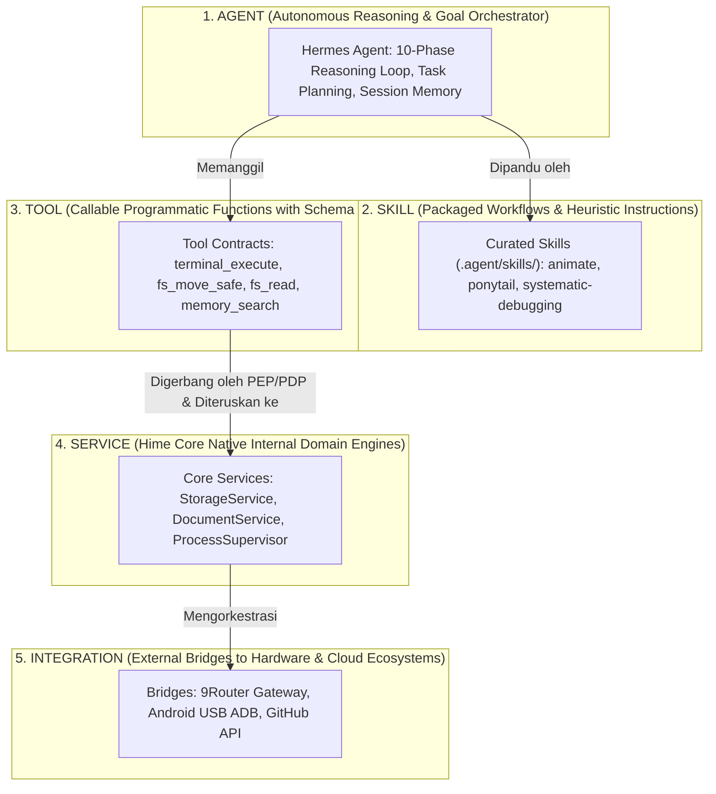
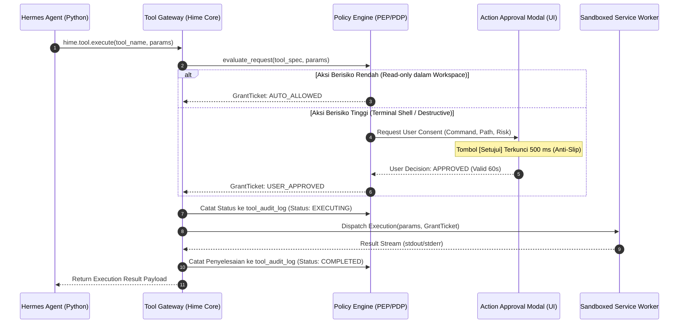

# Hime Tool & Service Architecture Specification

- **Document ID:** HIME-TOOL-AND-SERVICE-ARCHITECTURE
- **Task ID:** TASK-02-05 (System Architecture & Technical Design)
- **Phase:** Phase 02 — Nusa Reverse Engineering & Architecture Discovery
- **Authority:** Principal Software Architect & Senior Systems Engineer
- **Status:** **APPROVED ARCHITECTURAL SPECIFICATION — PENDING OWNER REVIEW**
- **Date:** 2026-11-08

---

## 1. Executive Summary & Conceptual Taxonomy

Dokumen ini mendefinisikan arsitektur pengelolaan alat (*tools*), layanan internal (*services*), keahlian (*skills*), dan integrasi eksternal (*integrations*) dalam ekosistem **Hime**.

Untuk mencegah kerancuan terminologi yang kerap terjadi dalam pengembangan sistem AI agentic, arsitektur Hime menetapkan pembedaan taksonomi 5 lapis yang tegas:



### Definisi Konseptual Baku:
1. **Agent:** Entitas penalaran otonom (Hermes Agent) yang menguraikan instruksi pengguna, menyusun rencana kerja multi-langkah, dan menentukan alat yang perlu dipanggil untuk mencapai tujuan.
2. **Skill:** Bundel instruksi kontekstual, heuristik kerja, dan pedoman operasional terstruktur (format `SKILL.md`) yang disuntikkan ke dalam sistem prompt agen untuk membimbing perilakunya.
3. **Tool:** Fungsi terprogram dengan skema input/output ketat yang didaftarkan ke model AI dan dipanggil saat model memutuskan memerlukan interaksi dengan dunia nyata.
4. **Service:** Modul logika bisnis internal native pada Hime Core (seperti `StorageService`, `DocumentService`) yang mengeksekusi aksi sistem secara terawasi.
5. **Integration:** Adapter jembatan khusus yang menghubungkan Hime Core dengan protokol luar (gateway 9Router, daemon Android ADB, REST API cloud).

---

## 2. Batasan Eksekusi Sub-Proses: Internal Runtime vs Delegated Tools

Sesuai kalibrasi presisi tata kelola TASK-02-04D, arsitektur membedakan secara tegas dua kategori pemanggilan proses:

| Kategori Sub-Proses | Karakteristik & Contoh Operasional | Status Kebijakan | Penegakan Keamanan (*Enforcement*) |
|:---|:---|:---:|:---|
| **Sub-proses Internal Runtime Python** | Operasi standar interpreter Python untuk siklus hidup internal (misal: cek `sys.executable`, inspeksi virtualenv, deteksi metadata modul terpasang). | **DIIZINKAN & TIDAK DIBLOKIR** | Terisolasi di dalam virtualenv Hermes; tidak dapat dipicu secara sewenang-wenang oleh prompt eksternal. |
| **Eksekusi Alat yang Didelegasikan (*Model-Requested Tool Call*)** | Aksi yang diminta oleh model AI (eksekusi terminal shell, manipulasi filesystem, akses jaringan, build kode). | **DILARANG KERAS MANDIRI** | Seluruh modul tool Hermes di-*shim* menjadi klien IPC yang meneruskan envelope ke Hime Core PEP/PDP. |
| **Aksi Sistem Tingkat OS (*Direct OS Actions*)** | Modifikasi registri Windows, manipulasi `/etc`, raw sockets, eskalasi privilege administrator. | **DIBLOKIR TOTAL** | Hard Deny mutlak oleh Hime Core Policy Engine; proses dijalankan tanpa token administrator. |

---

## 3. Spesifikasi Kontrak Alat Baku (Standard Tool Contract Specification)

Setiap alat yang terdaftar pada Hime Core wajib memiliki spesifikasi kontrak lengkap yang divalidasi oleh `Tool Gateway`:

```rust
pub struct ToolSpecification {
    pub tool_id: ToolId,
    pub version: SemVer,
    pub description: String,
    pub input_schema: serde_json::Value,   // JSON Schema Draft 7
    pub output_schema: serde_json::Value,
    pub required_permissions: Vec<PermissionType>,
    pub risk_tier: RiskTier,
    pub timeout_seconds: u32,
    pub supports_cancellation: bool,
    pub audit_classification: AuditCategory,
}

#[derive(Debug, Clone, Copy, PartialEq, Eq)]
pub enum RiskTier {
    Low,       // Operasi Read-Only, kalkulasi lokal (Auto-Allowed jika lolos whitelist)
    Medium,    // Operasi penulisan file lokal dalam workspace (Auto-Allowed / Notifikasi)
    High,      // Eksekusi terminal shell, pembersihan storage massal (Wajib Approval Modal)
}

#[derive(Debug, Clone, Copy, PartialEq, Eq)]
pub enum PermissionType {
    ReadWorkspace,
    WriteWorkspace,
    ExecuteShell,
    NetworkOutbound,
    ManageStorage,
    InspectSystem,
    AccessDevice,
    ModifySettings,
}
```

---

## 4. Katalog Kontrak Alat Inti (Core Tool Catalog MVP)

Tabel berikut menyajikan 8 kontrak alat inti yang didaftarkan pada Hime MVP:

### 1. `tool://fs_read`
- **Deskripsi:** Membaca isi berkas teks lokal di dalam batas direktori workspace aktif.
- **Tingkat Risiko:** `RiskTier::Low`
- **Izin yang Dibutuhkan:** `PermissionType::ReadWorkspace`
- **Input Schema:**
  ```json
  {
    "type": "object",
    "properties": {
      "path": { "type": "string", "description": "Path relatif berkas dari workspace" },
      "max_bytes": { "type": "integer", "default": 2097152 }
    },
    "required": ["path"]
  }
  ```
- **Output Schema:**
  ```json
  {
    "type": "object",
    "properties": {
      "content": { "type": "string" },
      "bytes_read": { "type": "integer" },
      "truncated": { "type": "boolean" },
      "sha256": { "type": "string" }
    },
    "required": ["content", "bytes_read", "truncated", "sha256"]
  }
  ```

---

### 2. `tool://fs_write`
- **Deskripsi:** Menulis atau memperbarui isi berkas teks di dalam batas direktori workspace aktif.
- **Tingkat Risiko:** `RiskTier::Medium`
- **Izin yang Dibutuhkan:** `PermissionType::WriteWorkspace`
- **Input Schema:**
  ```json
  {
    "type": "object",
    "properties": {
      "path": { "type": "string" },
      "content": { "type": "string" },
      "overwrite": { "type": "boolean", "default": false }
    },
    "required": ["path", "content"]
  }
  ```
- **Output Schema:**
  ```json
  {
    "type": "object",
    "properties": {
      "status": { "type": "string", "enum": ["CREATED", "OVERWRITTEN"] },
      "bytes_written": { "type": "integer" },
      "sha256": { "type": "string" }
    },
    "required": ["status", "bytes_written", "sha256"]
  }
  ```

---

### 3. `tool://fs_move_safe`
- **Deskripsi:** Memindahkan berkas secara aman menggunakan jaminan atomisitas same-volume atau siklus verifikasi bertahap cross-volume dengan jurnal Undo 30 hari.
- **Tingkat Risiko:** `RiskTier::Medium` (jika di dalam workspace) / `RiskTier::High` (jika di luar folder unduhan).
- **Izin yang Dibutuhkan:** `PermissionType::ManageStorage`
- **Input Schema:**
  ```json
  {
    "type": "object",
    "properties": {
      "source_path": { "type": "string" },
      "destination_path": { "type": "string" }
    },
    "required": ["source_path", "destination_path"]
  }
  ```
- **Output Schema:**
  ```json
  {
    "type": "object",
    "properties": {
      "operation_id": { "type": "string" },
      "is_cross_volume": { "type": "boolean" },
      "sha256": { "type": "string" },
      "undo_available_until_utc": { "type": "integer" }
    },
    "required": ["operation_id", "is_cross_volume", "sha256"]
  }
  ```

---

### 4. `tool://terminal_execute`
- **Deskripsi:** Menjalankan perintah terminal terisolasi di bawah supervisi Process Supervisor Job Object.
- **Tingkat Risiko:** **`RiskTier::High` (Wajib Action Approval Modal dengan jeda 500 ms anti-slip)**
- **Izin yang Dibutuhkan:** `PermissionType::ExecuteShell`
- **Input Schema:**
  ```json
  {
    "type": "object",
    "properties": {
      "command": { "type": "string" },
      "working_dir": { "type": "string" },
      "timeout_seconds": { "type": "integer", "default": 30 }
    },
    "required": ["command"]
  }
  ```
- **Output Schema:**
  ```json
  {
    "type": "object",
    "properties": {
      "exit_code": { "type": "integer" },
      "stdout": { "type": "string" },
      "stderr": { "type": "string" },
      "duration_ms": { "type": "integer" },
      "audit_id": { "type": "string" }
    },
    "required": ["exit_code", "stdout", "stderr", "duration_ms", "audit_id"]
  }
  ```

---

### 5. `tool://memory_fts_search`
- **Deskripsi:** Mencari konteks relevan dari riwayat percakapan dan dokumen kerja menggunakan indeks SQLite FTS5.
- **Tingkat Risiko:** `RiskTier::Low`
- **Izin yang Dibutuhkan:** `PermissionType::ReadWorkspace`
- **Input Schema:**
  ```json
  {
    "type": "object",
    "properties": {
      "query": { "type": "string" },
      "limit": { "type": "integer", "default": 5 }
    },
    "required": ["query"]
  }
  ```
- **Output Schema:**
  ```json
  {
    "type": "object",
    "properties": {
      "snippets": {
        "type": "array",
        "items": {
          "type": "object",
          "properties": {
            "title": { "type": "string" },
            "content": { "type": "string" },
            "source_type": { "type": "string" },
            "timestamp_utc": { "type": "integer" }
          }
        }
      }
    },
    "required": ["snippets"]
  }
  ```

---

### 6. `tool://system_status_inspect`
- **Deskripsi:** Memeriksa metrik sistem lokal (kapasitas RAM bebas, ruang hard disk, status baterai laptop).
- **Tingkat Risiko:** `RiskTier::Low`
- **Izin yang Dibutuhkan:** `PermissionType::InspectSystem`
- **Input Schema:**
  ```json
  {
    "type": "object",
    "properties": {
      "target_metrics": {
        "type": "array",
        "items": { "type": "string", "enum": ["RAM", "DISK", "BATTERY"] }
      }
    }
  }
  ```
- **Output Schema:**
  ```json
  {
    "type": "object",
    "properties": {
      "free_ram_mb": { "type": "integer" },
      "free_disk_mb": { "type": "integer" },
      "battery_percent": { "type": "integer" },
      "is_charging": { "type": "boolean" }
    }
  }
  ```

---

### 7. `tool://device_adb_pull` (Phase 2)
- **Deskripsi:** Menarik berkas foto atau dokumen dari smartphone Android yang terhubung via kabel USB ADB ke laptop.
- **Tingkat Risiko:** `RiskTier::Medium`
- **Izin yang Dibutuhkan:** `PermissionType::AccessDevice`

---

### 8. `tool://browser_navigate` (Phase 2/3)
- **Deskripsi:** Membuka URL web pada browser headless Playwright untuk mengambil cuplikan teks artikel.
- **Tingkat Risiko:** `RiskTier::Medium`
- **Izin yang Dibutuhkan:** `PermissionType::NetworkOutbound`

---

## 5. Alur Registrasi & Pemanggilan Alat (Tool Dispatch Flow)



---

## 6. Audit Trail & Pencatatan Transaksional

Setiap eksekusi alat dicatat secara permanen pada basis data lokal `tool_audit_log`:
```sql
CREATE TABLE tool_audit_log (
    audit_id TEXT PRIMARY KEY,
    correlation_id TEXT NOT NULL,
    timestamp_utc INTEGER NOT NULL,
    tool_name TEXT NOT NULL,
    permission_type TEXT NOT NULL,
    risk_level TEXT NOT NULL,
    command_payload TEXT NOT NULL,
    target_path TEXT,
    authorization_decision TEXT NOT NULL, -- 'AUTO_ALLOWED', 'USER_APPROVED', 'USER_DENIED', 'POLICY_REJECTED'
    execution_duration_ms INTEGER,
    exit_code INTEGER,
    error_message TEXT
);
CREATE INDEX idx_tool_audit_corr ON tool_audit_log (correlation_id);
CREATE INDEX idx_tool_audit_time ON tool_audit_log (timestamp_utc);
```
Dengan struktur ini, setiap aksi yang dijalankan agen memiliki jejak audit yang dapat diaudit secara forensik, transparan bagi pengguna, dan bebas dari ambiguitas.
