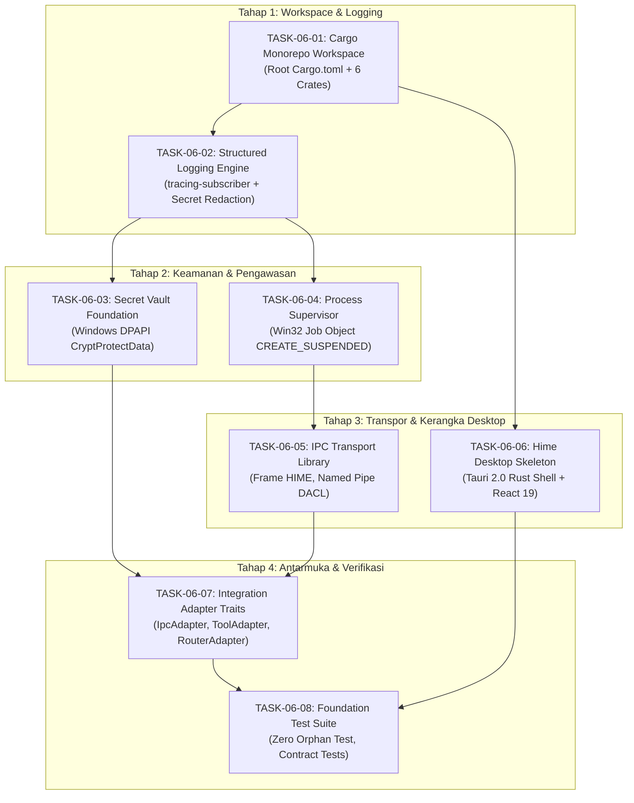

# Master Index: Hime Implementation Specifications & Phase 06 Readiness

- **Document ID:** HIME-SPEC-INDEX-04
- **Phase:** Phase 04 — Engineering Planning & Implementation Specification
- **Authority:** System Architect & Technical Lead
- **Execution Role:** Senior Systems Engineer & Software Architect
- **Status:** **VALIDATED SPECIFICATION INDEX — PHASE 04 COMPLETE**
- **Date:** 2026-11-10

---

## 1. Executive Summary & Index Purpose

Dokumen ini merupakan indeks kanonikal yang menyatukan, memvalidasi konsistensi, dan memetakan keterkaitan antara **8 dokumen spesifikasi teknis modular Phase 04** terhadap 12 Architecture Decision Records (ADR-001 s/d ADR-012), 16 Batasan Implementasi resmi, serta paket persiapan eksekusi kode sumber pada **Phase 06 (Engineering Foundation)**.

Seluruh spesifikasi dalam indeks ini telah melalui proses **Validasi Arsitektural dan Koreksi Terarah (*Targeted Architectural Calibration*)** untuk mengeliminasi asumsi tidak realistis, mengualifikasikan klaim absolut, dan menyesuaikan rancangan dengan batasan sistem operasi nyata.

---

## 2. Inventaris Dokumen Spesifikasi Implementasi (Phase 04 Deliverables)

| Dokumen Spesifikasi | Task ID | File Path | Status Validasi | Fokus Teknis Utama |
|:---|:---:|:---|:---:|:---|
| **1. Component Boundaries & Ownership** | TASK-04-01 | [`COMPONENT-BOUNDARIES-AND-OWNERSHIP.md`](file:///x:/folder_ai/Hime/project-management/system-architecture/implementation/COMPONENT-BOUNDARIES-AND-OWNERSHIP.md) | VALIDATED | Batas tanggung jawab 6 crate workspace, Ports & Adapters, isolasi 4 proses. |
| **2. IPC Binary Protocol Specification** | TASK-04-02 | [`IPC-BINARY-PROTOCOL-SPECIFICATION.md`](file:///x:/folder_ai/Hime/project-management/system-architecture/implementation/IPC-BINARY-PROTOCOL-SPECIFICATION.md) | VALIDATED | Framing biner 12-byte `HIME`, batas 16 MiB, scoped nonces, test vectors biner. |
| **3. Subprocess Lifecycle Specification** | TASK-04-03 | [`SUBPROCESS-LIFECYCLE-SPECIFICATION.md`](file:///x:/folder_ai/Hime/project-management/system-architecture/implementation/SUBPROCESS-LIFECYCLE-SPECIFICATION.md) | VALIDATED | Win32 Job Object `CREATE_SUSPENDED`, assignment fail-closed, Linux `PR_SET_PDEATHSIG`. |
| **4. 9Router Credential Security (IB-01)** | TASK-04-04 | [`9ROUTER-CREDENTIAL-SECURITY-SPECIFICATION.md`](file:///x:/folder_ai/Hime/project-management/system-architecture/implementation/9ROUTER-CREDENTIAL-SECURITY-SPECIFICATION.md) | **IB-01 OPEN** | Analisis realitas 9Router, evaluasi 4 alternatif, Hime-owned adapter vs fork. |
| **5. 9Router Localhost Security (IB-02)** | TASK-04-05 | [`9ROUTER-LOCALHOST-SECURITY-SPECIFICATION.md`](file:///x:/folder_ai/Hime/project-management/system-architecture/implementation/9ROUTER-LOCALHOST-SECURITY-SPECIFICATION.md) | **IB-02 OPEN** | Keterbatasan non-admin Windows 11, penegakan token native 9Router, port ephemeral. |
| **6. Storage & Filesystem Safety** | TASK-04-06 | [`STORAGE-AND-FILESYSTEM-SAFETY-SPECIFICATION.md`](file:///x:/folder_ai/Hime/project-management/system-architecture/implementation/STORAGE-AND-FILESYSTEM-SAFETY-SPECIFICATION.md) | VALIDATED | Non-atomic 7-step cross-volume move, FTS5 trigram multibahasa, SQLite WAL. |
| **7. Observability & Structured Logging** | TASK-04-07 | [`OBSERVABILITY-AND-LOGGING-SPECIFICATION.md`](file:///x:/folder_ai/Hime/project-management/system-architecture/implementation/OBSERVABILITY-AND-LOGGING-SPECIFICATION.md) | VALIDATED | Keterbatasan memori `Zeroize`, allowlist fields, redaksi regex 4-lapis. |
| **8. QA & Definition of Done** | TASK-04-08 | [`QUALITY-ASSURANCE-AND-DEFINITION-OF-DONE.md`](file:///x:/folder_ai/Hime/project-management/system-architecture/implementation/QUALITY-ASSURANCE-AND-DEFINITION-OF-DONE.md) | **0 EXECUTED** | Traceability matrix (owner, test ID, expected result, acceptance criteria), DoD. |

---

## 3. Matriks Penyelarasan Terhadap Architecture Decision Records (ADRs)

| ADR ID | Judul Keputusan Arsitektural | Dokumen Spesifikasi Pelaksana | Status & Catatan Penyelarasan Terkalibrasi |
|:---:|:---|:---|:---|
| **ADR-001** | Topologi 4-Proses Terisolasi | `COMPONENT-BOUNDARIES-AND-OWNERSHIP.md` | **Terspesifikasi Penuh:** Bounded contexts memisahkan UI, Core, Hermes, dan 9Router. |
| **ADR-002** | Modular Monolith Rust untuk Hime Core | `COMPONENT-BOUNDARIES-AND-OWNERSHIP.md` | **Terspesifikasi Penuh:** Sub-domain didecouple via trait ports dan channel Tokio. |
| **ADR-003** | Framing Biner IPC Cross-Platform | `IPC-BINARY-PROTOCOL-SPECIFICATION.md` | **Terspesifikasi Penuh:** Header 12-byte `HIME` + JSON-RPC 2.0; scoped nonces anti-replay. |
| **ADR-004** | Dual-Control Plane untuk 9Router | `9ROUTER-LOCALHOST-SECURITY-SPECIFICATION.md` | **Terkalibrasi (IB-02 OPEN):** Keterbatasan non-admin diakui; penegakan via native token auth. |
| **ADR-005** | Centralized PEP/PDP di Hime Core | `COMPONENT-BOUNDARIES-AND-OWNERSHIP.md` | **Terspesifikasi Penuh:** 100% tool invocation wajib melalui Policy Engine Hime Core. |
| **ADR-006** | Zero Upstream Modification Policy | `9ROUTER-CREDENTIAL-SECURITY-SPECIFICATION.md` | **Terkalibrasi (IB-01 OPEN):** Evaluasi membuktikan in-flight proxy butuh loopback adapter. |
| **ADR-007** | Single-Writer WAL SQLite + FTS5 | `STORAGE-AND-FILESYSTEM-SAFETY-SPECIFICATION.md` | **Terspesifikasi Penuh:** FTS5 trigram untuk CJK/multibahasa; single-writer thread pool. |
| **ADR-008** | 5-Dimensi Integritas Sistem Berkas | `STORAGE-AND-FILESYSTEM-SAFETY-SPECIFICATION.md` | **Terspesifikasi Penuh:** Cross-volume dikualifikasikan non-atomik; 7-step crash-safe. |
| **ADR-009** | Zero-Trust Local IPC & Anti-Replay | `IPC-BINARY-PROTOCOL-SPECIFICATION.md` | **Terspesifikasi Penuh:** Scoped nonces, CSPRNG one-time handshake, client PID verification. |
| **ADR-010** | Dynamic Island Cross-Platform Window | `COMPONENT-BOUNDARIES-AND-OWNERSHIP.md` | **Terspesifikasi Penuh:** DirectComposition Win32 hook & Wayland Floating Companion fallback. |
| **ADR-011** | Resource Budget & Concurrency MVP | `QUALITY-ASSURANCE-AND-DEFINITION-OF-DONE.md` | **Terspesifikasi Penuh:** Batas konkurensi tepat 1 active agent task; RAM budget 215MB idle. |
| **ADR-012** | Enkripsi Kredensial Wrapper DPAPI | `9ROUTER-CREDENTIAL-SECURITY-SPECIFICATION.md` | **Terkalibrasi (IB-01 OPEN):** DPAPI hanya melindungi vault; 9Router DB butuh penanganan khusus. |

---

## 4. Matriks Dependensi Persiapan Eksekusi Phase 06

---

## 5. Keputusan Arsitektur Terbuka (Open Architecture Decisions)

| ID Keputusan | Deskripsi Isu Arsitektural | Pilihan Solusi yang Tersedia | Rekomendasi Tim Rekayasa |
|:---:|:---|:---|:---|
| **OD-04-01** | Strategi In-Flight Kredensial 9Router (IB-01) | **Opsi A:** Custom Node Loopback Adapter di Hime Core. **Opsi B:** Controlled Upstream Patch/Fork 9Router. | **Opsi A (Recommended):** Mempertahankan ADR-006 tanpa modifikasi source 9Router. |
| **OD-04-02** | Strategi Autentikasi Localhost 9Router (IB-02) | **Opsi A:** Pemberdayaan token master `apiKeys` internal 9Router. **Opsi B:** Penggunaan WFP driver kernel Windows. | **Opsi A (Recommended):** Satu-satunya opsi yang layak tanpa memerlukan hak administrator. |
| **OD-04-03** | Format Serialisasi Konfigurasi Runtime | **Opsi A:** File JSON murni (`serde_json`). **Opsi B:** File TOML (`toml` crate). | **Opsi B (Recommended):** Lebih ramah dibaca manusia dan mendukung komentar konfigurasi. |
