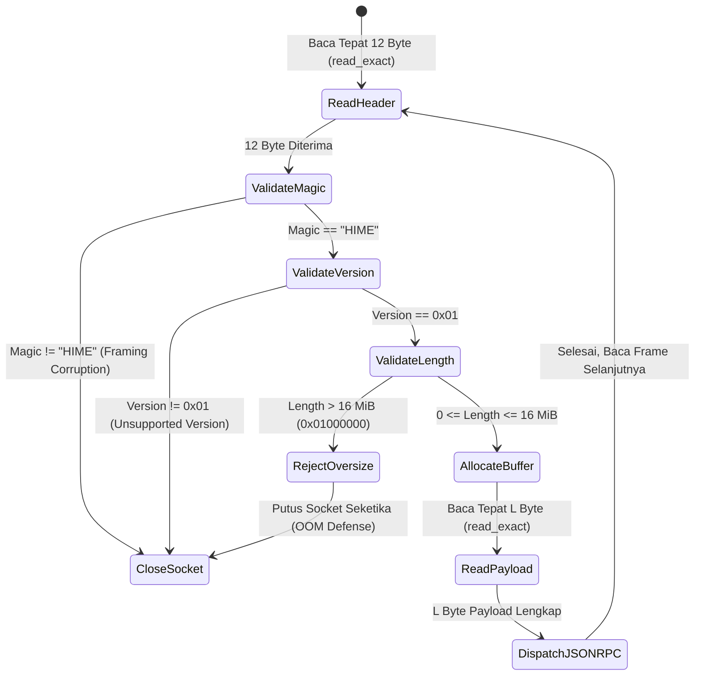
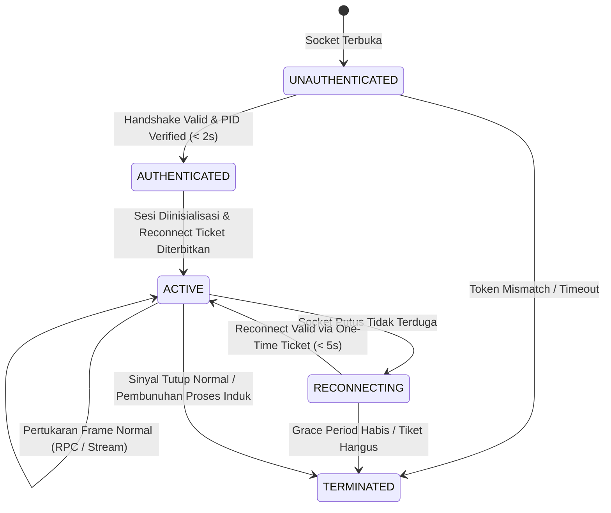
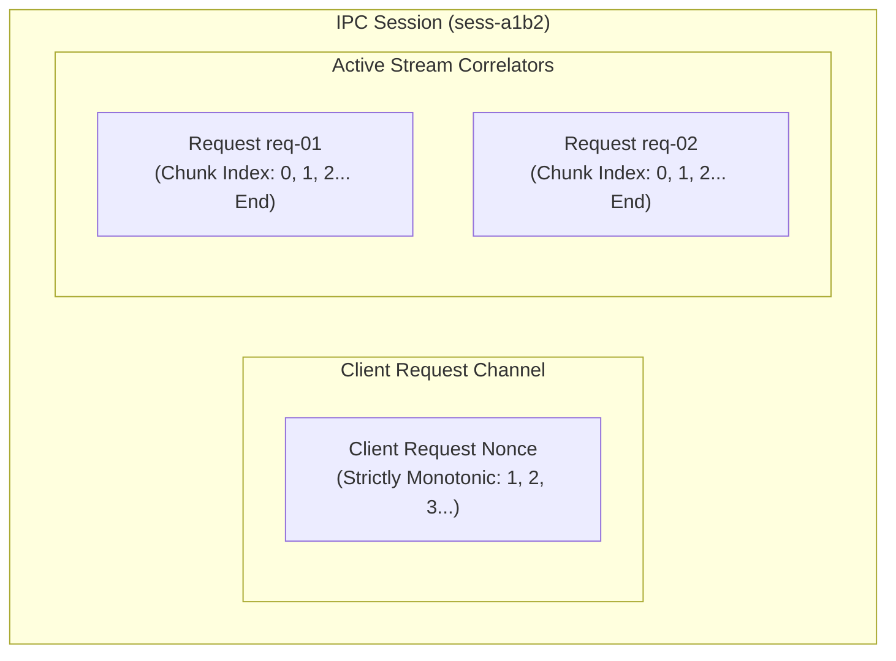

# IPC Binary Protocol & Security Layer Specification

- **Document ID:** HIME-SPEC-04-02
- **Task ID:** TASK-04-02 (IPC Binary Protocol Specification)
- **Phase:** Phase 04 — Engineering Planning & Implementation Specification
- **Authority:** System Architect & Technical Lead
- **Execution Role:** Senior Systems Engineer & Protocol Architect
- **Status:** **VALIDATED TECHNICAL SPECIFICATION**
- **Date:** 2026-11-10

---

## 1. Executive Summary & Layered Architecture

Dokumen ini mendefinisikan secara presisi spesifikasi protokol komunikasi antar-proses (*Inter-Process Communication / IPC*) berkecepatan tinggi, berlatensi rendah, dan aman (*memory-safe*) yang menghubungkan **Hime Core**, **Hime Desktop**, dan **Hermes Agent Subprocess**.

Protokol ini menerapkan arsitektur 4-lapis:
1. **Transport Layer:** Windows Named Pipe (`\\.\pipe\hime-hermes`) dengan DACL Current User SID eksklusif, dan Linux Unix Domain Socket (`$XDG_RUNTIME_DIR/hime/hermes.sock`, mode `0600`) dengan verifikasi `SO_PEERCRED`.
2. **Binary Framing Layer (`HIME` Frame):** Header biner 12-byte fixed-size yang menyediakan batas pesan (*framing boundary*), deteksi korupsi stream, dan proteksi pre-alokasi memori.
3. **Session & Security Layer:** State machine sesi autentikasi, pertukaran tiket re-koneksi sekali pakai (*one-time reconnect tickets*), dan *scoped sequence nonces* untuk proteksi anti-replay yang aman terhadap konkurensi.
4. **Application Payload Layer:** Protokol terstandarisasi **JSON-RPC 2.0** (UTF-8 encoding) yang mendukung request-response ber-ID unik, stream chunking, dan pembatalan tugas.

---

## 2. Tata Letak Biner Framing `HIME` (12-Byte Fixed Header)

Setiap paket data pada saluran IPC diawali dengan header biner tetap sebesar **12 byte**, diikuti oleh payload data:

```text
 0                   1                   2                   3
 0 1 2 3 4 5 6 7 8 9 0 1 2 3 4 5 6 7 8 9 0 1 2 3 4 5 6 7 8 9 0 1
+-+-+-+-+-+-+-+-+-+-+-+-+-+-+-+-+-+-+-+-+-+-+-+-+-+-+-+-+-+-+-+-+
|                  Magic: 'H' 'I' 'M' 'E' (0x48494D45)          |
+-+-+-+-+-+-+-+-+-+-+-+-+-+-+-+-+-+-+-+-+-+-+-+-+-+-+-+-+-+-+-+-+
|  Version(0x01)|  MsgType(0x..) |          Reserved (0x0000)    |
+-+-+-+-+-+-+-+-+-+-+-+-+-+-+-+-+-+-+-+-+-+-+-+-+-+-+-+-+-+-+-+-+
|                   Payload Length (Big-Endian u32)             |
+-+-+-+-+-+-+-+-+-+-+-+-+-+-+-+-+-+-+-+-+-+-+-+-+-+-+-+-+-+-+-+-+
|                   Payload Data (JSON-RPC 2.0 UTF-8)           |
|                               ...                             |
+-+-+-+-+-+-+-+-+-+-+-+-+-+-+-+-+-+-+-+-+-+-+-+-+-+-+-+-+-+-+-+-+
```

### Rincian Bidang Header (Field Definitions):

| Offset | Panjang | Nama Field | Tipe Data | Nilai yang Sah | Keterangan Teknis |
|:---:|:---:|:---|:---:|:---:|:---|
| **0..3** | 4 byte | `Magic` | Byte Array | `[0x48, 0x49, 0x4D, 0x45]` (`"HIME"`) | Identifier protokol unik untuk menolak data acak / scanner socket. |
| **4** | 1 byte | `Version` | `u8` unsigned | `0x01` | Versi protokol IPC saat ini (v1.0). |
| **5** | 1 byte | `MsgType` | `u8` enum | `0x01` s/d `0x06` | Tipe pesan framing (lihat tabel di bawah). |
| **6..7** | 2 byte | `Reserved` | `u16` unsigned | `0x0000` | Dicadangkan untuk ekstensi masa depan. Wajib bernilai 0. |
| **8..11**| 4 byte | `PayloadLength`| `u32` Big-Endian | $0 \le L \le 16,777,216$ | Panjang payload data dalam byte. Maksimum $16\text{ MiB}$ (`0x01000000`). |

### Nilai Enumerasi Message Type (`MsgType`):
- `0x01` — **Handshake / RPC Request:** Permintaan dari pengirim yang mengharapkan balasan (`id` wajib ada).
- `0x02` — **RPC Response:** Balasan final dari suatu permintaan (`id` mencocokkan request).
- `0x03` — **Notification:** Pesan satu arah tanpa balasan (`id` tidak ada / null).
- `0x04` — **StreamChunk:** Potongan aliran data streaming (token LLM) yang terikat pada request `id`.
- `0x05` — **StreamEnd:** Penanda akhir aliran data streaming untuk request `id` tertentu.
- `0x06` — **Cancel:** Permintaan pembatalan tugas aktif yang sedang berjalan.

---

## 3. Algoritma Parsing Frame & Penanganan I/O Parsial

Untuk mencegah serangan *Denial of Service (DoS)*, kehabisan memori (*heap exhaustion / OOM*), dan korupsi data akibat pembacaan I/O parsial:



### Aturan Rekayasa Parser Mutlak:
1. **Pre-Allocation Guard (Aturan Anti-OOM):**
   Buffer memori (`Vec<u8>::with_capacity(len)`) **DILARANG KERAS** dialokasikan sebelum `PayloadLength` divalidasi. Jika `PayloadLength > 16,777,216` (16 MiB), koneksi langsung diputus tanpa mengalokasikan byte heap apa pun.
2. **Partial Reads & Writes Handling:**
   Driver I/O wajib menggunakan primitif asinkron yang menjamin pembacaan tepat panjang byte yang diminta (`tokio::io::AsyncReadExt::read_exact`). Stream yang terputus di tengah frame (*unexpected EOF*) diperlakukan sebagai pemutusan koneksi bersih tanpa melempar panic runtime.
3. **Pemisahan Perilaku Error Framing vs JSON-RPC:**
   - **Galat Framing Biner (Magic salah, Version salah, Reserved != 0, Length > 16MB):** Mengindikasikan desinkronisasi stream atau serangan socket. Koneksi transport **SEKETIKA DIPUTUS** (*Fail-Closed*).
   - **Galat Payload JSON-RPC (JSON malformed, method unknown, schema invalid):** Saluran biner tetap sehat. Server membalas dengan frame `MsgType = 0x02 (Response)` berisi objek JSON-RPC error standar (`-32700 Parse error`, `-32601 Method not found`) tanpa memutus transport.

---

## 4. State Machine Sesi Autentikasi & Rotasi Tiket

Komunikasi IPC diatur oleh state machine sesi yang ketat:



### Alur Kerja Handshake & Rotasi Tiket:
1. **Inisialisasi Awal:** Subproses diluncurkan dengan token awal 256-bit CSPRNG (`HIME_IPC_AUTH_TOKEN`).
2. **Handshake Ketat:** Klien wajib mengirimkan request `system.handshake` dalam waktu $\le 2000\text{ms}$ sejak koneksi terbuka.
3. **Tiket Re-koneksi Sekali Pakai (*One-Time Reconnect Ticket*):**
   - Saat handshake berhasil, Hime Core menerbitkan `session_id` acak dan `reconnect_ticket` sekali pakai dengan masa berlaku 5 detik.
   - Jika socket Named Pipe atau UDS terputus sementara (misalnya karena restart thread pembaca), klien dapat melakukan reconnect dan menyajikan `reconnect_ticket` tersebut.
   - Tiket langsung hangus (*invalidated on first use*) setelah digunakan atau setelah batas waktu 5 detik berakhir, mencegah serangan replay tiket sesi.

---

## 5. Sequence Nonces Berlingkup (*Scoped Sequence Nonces*) & Proteksi Replay

### Masalah Replay Monotonik Global pada Konkurensi:
Menerapkan satu sequence counter monotonik tunggal ($N = N_{\text{last}} + 1$) pada koneksi yang melayani banyak request simultan (*concurrent multiplexed requests*) dan token streaming asinkron terbukti menyebabkan *race condition* dan false positive `REPLAY_ATTACK_DETECTED`.

### Solusi Desain Hime: *Scoped Sequence Nonces*
Arsitektur Hime membagi penomoran urutan ke dalam lingkup yang terisolasi:



### Aturan Penegakan Nonce:
1. **Lingkup Request Nonce:** Nonce pada metadata `meta.nonce` **HANYA BERLAKU UNTUK CLIENT-INITIATED REQUESTS**. Server mempertahankan counter `last_request_nonce` per sesi. Setiap request baru wajib memenuhi $N > N_{\text{last}}$.
2. **Lingkup Stream Chunk:** Aliran streaming LLM (`MsgType = 0x04`) tidak memajukan request nonce sesi, melainkan menggunakan `chunk_seq` yang terikat pada request ID terkait (`id`).
3. **Request Correlation ID:** Setiap panggilan memiliki string identifier unik (UUIDv4 atau format kustom `req-xxxx`). Balasan RPC dan frame pembatalan wajib mencantumkan ID korelasi yang sama.
4. **Toleransi Jam Sistem:** Timestamp pesan divalidasi terhadap waktu lokal host dengan batas deviasi $|T_{\text{msg}} - T_{\text{host}}| \le 5\text{ detik}$.

---

## 6. Vektor Uji Protokol Biner (Test Vectors for Implementation)

Berikut adalah test vectors byte-level yang dapat dijadikan acuan pengujian langsung saat menulis kode parser biner pada Phase 06:

### Test Vector 1: Valid Handshake Request Frame
- **Tipe:** `MsgType = 0x01 (Request)`
- **Payload:** `{"jsonrpc":"2.0","method":"system.handshake","params":{"token":"abc..."},"id":"h-1"}` (panjang: 75 byte = `0x0000004B`)
- **Byte Stream (Heksadesimal):**
  ```text
  Header:
  48 49 4D 45  (Magic: "HIME")
  01           (Version: 1)
  01           (MsgType: 0x01 Handshake/Request)
  00 00        (Reserved: 0x0000)
  00 00 00 4B  (Payload Length: 75 bytes)
  Payload:
  7B 22 6A 73 6F 6E 72 70 63 22 3A 22 32 2E 30 22 ... 22 68 2D 31 22 7D
  ```
- **Hasil yang Diharapkan:** Header diterima valid, alokasi buffer 75 byte, parser mendistribusikan request ke handler handshake.

### Test Vector 2: Valid StreamChunk Frame
- **Tipe:** `MsgType = 0x04 (StreamChunk)`
- **Payload:** `{"jsonrpc":"2.0","method":"stream.chunk","params":{"chunk_seq":3,"content":"Hello"},"id":"req-42"}` (panjang: 80 byte = `0x00000050`)
- **Byte Stream (Heksadesimal):**
  ```text
  Header:
  48 49 4D 45  (Magic: "HIME")
  01           (Version: 1)
  04           (MsgType: 0x04 StreamChunk)
  00 00        (Reserved: 0x0000)
  00 00 00 50  (Payload Length: 80 bytes)
  Payload:
  7B 22 6A 73 6F 6E 72 70 63 22 ... 22 72 65 71 2D 34 32 22 7D
  ```
- **Hasil yang Diharapkan:** Frame streaming berhasil didecode dan diteruskan ke subscriber stream `req-42`.

### Test Vector 3: Malformed Header (Corrupt Magic Bytes)
- **Byte Stream (Heksadesimal):**
  ```text
  Header:
  42 41 44 21  (Magic: "BAD!")
  01 01 00 00 00 00 00 10
  ```
- **Hasil yang Diharapkan:** Parser mendeteksi `Magic != "HIME"`. Transport socket **seketika diputus**, 0 byte dialokasikan di heap, error dicatat di log.

### Test Vector 4: Oversized Payload Length (OOM Exploit Defense)
- **Byte Stream (Heksadesimal):**
  ```text
  Header:
  48 49 4D 45  (Magic: "HIME")
  01 01 00 00
  01 00 00 01  (Payload Length: 16,777,217 bytes > 16 MiB)
  ```
- **Hasil yang Diharapkan:** Parser mendeteksi `Length > 16 MiB`. Permintaan **ditolak seketika sebelum alokasi buffer**, transport socket diputus, error `FRAME_TOO_LARGE` dibangkitkan.
