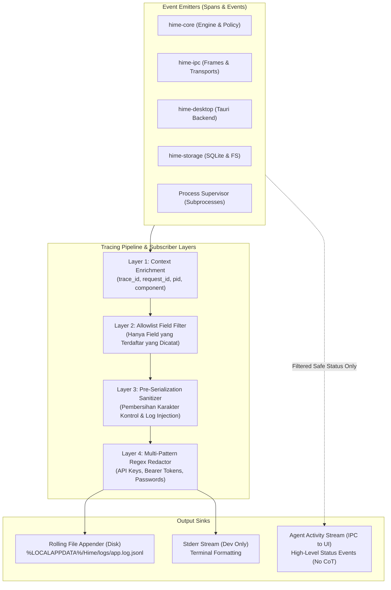

# Observability, Structured Logging & Privacy Redaction Specification

- **Document ID:** HIME-SPEC-04-07
- **Task ID:** TASK-04-07 (Observability & Structured Logging Specification)
- **Phase:** Phase 04 — Engineering Planning & Implementation Specification
- **Authority:** System Architect & Technical Lead
- **Execution Role:** Senior Systems Engineer & Observability Architect
- **Status:** **VALIDATED TECHNICAL SPECIFICATION**
- **Date:** 2026-11-10

---

## 1. Executive Summary & Observability Philosophy

Dokumen ini mendefinisikan arsitektur observability, structured logging, metrik performa, dan pengawasan sumber daya terpadu untuk ekosistem Hime menggunakan ekosistem Rust `tracing`.

### Prinsip Keamanan & Privasi Mutlak:
1. **Zero Secret Leakage:** Kunci API, bearer token, password, atau konten berkas sensitif **DILARANG KERAS muncul dalam bentuk plaintext pada berkas log atau diagnostik**.
2. **Pemisahan Log Operasional vs Agent Activity Stream:**
   - *Log Operasional:* Log teknis terstruktur berbasis JSONL untuk keperluan debugging pengembang yang disimpan pada disk lokal terisolasi.
   - *Agent Activity Stream:* Aliran status visual tingkat tinggi yang disajikan kepada pengguna di UI Desktop (Dynamic Island / Drawer) yang **DILARANG KERAS mengekspos penalaran pribadi model (*Private Chain-of-Thought*)**.
3. **Pertahanan Berlapis (*Defense-in-Depth Redaction*):** Redaksi kredensial tidak hanya mengandalkan satu mekanisme, melainkan menerapkan pengikatan tipe aman (*Type-Level Redaction*), pembersihan sebelum serialisasi (*Pre-Serialization Sanitization*), allowlist bidang yang diizinkan dicatat, dan filter regex multi-pola.

---

## 2. Keterbatasan Nyata `Zeroize` & Proliferasi Memori Runtime

Spesifikasi ini secara eksplisit **TIDAK MENGKLAIM BAHWA `Zeroize` DAPAT MENGHAPUS SELURUH SALINAN KREDENSIAL DARI MEMORI SISTEM**.

### Realitas Batasan Perlindungan Memori:
Mekanisme `Zeroize` pada Rust hanya menjamin bahwa buffer memori spesifik yang dibungkus oleh struct tersebut akan di-overwrite dengan byte `0x00` saat struct keluar dari scope (`drop`). Namun, dalam aplikasi modern berkinerja tinggi, salinan (*copies*) kredensial dapat berproliferasi secara tidak terkontrol pada beberapa lapisan berikut:

1. **HTTP Client & TLS Buffers:** Pustaka HTTP client (seperti `reqwest`, `hyper`, `rustls`) menyalin header autentikasi ke dalam buffer soket TCP, buffer TLS ciphertext/plaintext, dan ring buffer internal yang dikelola oleh alokator memori global dan tidak di-zeroize saat koneksi ditutup.
2. **Serialisasi JSON (`serde_json`):** Saat merangkai body JSON atau mem-parse balasan JSON, serialisator membuat alokasi heap sementara (`String`, slice memori) yang dikembalikan ke pool alokator memori OS tanpa pembersihan byte (`deallocate` standar tidak menimpa memori dengan 0).
3. **Register Spills & Stack Moves Compiler:** Optimasi compiler LLVM dapat menyalin nilai variabel ke stack frame atau register CPU sementara. Stack frame ini tetap berisi data residu hingga tertimpa oleh pemanggilan fungsi lain di masa depan.
4. **Error Messages dari Pustaka Pihak Ketiga:** Ketika terjadi kegagalan jaringan atau parsing, pustaka HTTP dapat merangkai string error yang mencakup URL lengkap atau potongan header yang memuat kunci API.
5. **Panic Diagnostics & Core Dumps:** Jika proses mengalami panic atau crash yang memicu pembuatan crash dump (minidump Windows / coredump Linux), memori heap dan stack dapat disalin utuh ke disk dalam bentuk file dump unencrypted.
6. **Subprocess Environment Blocks:** Parameter yang diteruskan ke subproses via environment variable tersimpan di Process Environment Block (`PEB`) pada ruang memori subproses yang dapat dibaca oleh alat diagnostik OS.

### Implikasi Desain:
Karena penghapusan total memori secara matematis mustahil dijamin hanya dengan `Zeroize`, Hime wajib menerapkan pertahanan berlapis:
- **Kredensial didekripsi sedekat mungkin dengan titik pemanggilan jaringan (*Just-In-Time Decryption*).**
- **Menggunakan custom panic hook** untuk mencegah minidump mencatat buffer sensitif.
- **Mencegah kebocoran ke lapisan log dan antarmuka** melalui allowlist dan pemfilteran sebelum serialisasi.

---

## 3. Arsitektur Structured Logging Berbasis Ekosistem Rust `tracing`



---

## 4. Kebijakan Redaksi Bertingkat (Defense-in-Depth Redaction Engine)

Untuk menjamin tidak ada kredensial yang bocor ke berkas log (**SEC-09**), Hime menerapkan 4 lapis kontrol keamanan:

### Lapis 1: Type-Level Protection (`Secret<T>` Pattern)
Kredensial atau token sensitif di dalam kode Rust wajib dibungkus dalam tipe khusus yang mengabstraksikan trait `Debug` dan `Display`:
```rust
pub struct SecretString(zeroize::Zeroizing<String>);

impl std::fmt::Debug for SecretString {
    fn fmt(&self, f: &mut std::fmt::Formatter<'_>) -> std::fmt::Result {
        write!(f, "[REDACTED_SECRET]")
    }
}
impl std::fmt::Display for SecretString {
    fn fmt(&self, f: &mut std::fmt::Formatter<'_>) -> std::fmt::Result {
        write!(f, "[REDACTED_SECRET]")
    }
}
```
*Hasil:* Pengembang tidak dapat secara tidak sengaja mencetak kunci API menggunakan makro `tracing::info!("{:?}", api_key)` karena format output otomatis menghasilkan string `[REDACTED_SECRET]`.

### Lapis 2: Allowlist Bidang Loggable (Strict Field Allowlisting)
Hanya bidang metadata tertentu yang diizinkan masuk ke dalam field log terstruktur:
- **DIIZINKAN (Allowlist):**
  * `trace_id`, `request_id`, `component`, `tool_name`, `file_extension`, `status_code`, `latency_ms`, `byte_count`, `session_id`, `task_id`, `exit_code`, `peer_pid`.
- **DILARANG KERAS (Strict Blocklist):**
  * `api_key`, `token`, `password`, `prompt_text`, `completion_text`, `full_file_content`, `reasoning_content`, `auth_header`.

### Lapis 3: Pre-Serialization Input Sanitization (Anti-Log Injection)
Teks yang bersumber dari input luar (argumen tool, pesan error subproses) dibersihkan dari karakter kontrol terminal (`\x1b[...m` ANSI escape sequences) dan karakter pemisah baris (`\r`, `\n`) sebelum diserialisasi ke JSON untuk mencegah serangan *Log Injection*.

### Lapis 4: Multi-Pattern Regex Redaction Filter
Sebagai lapis pengaman cadangan (*fallback safety net*), seluruh string output diproses melalui regex filter terkompilasi sebelum menyentuh file sink:
- Format OpenAI: `sk-[a-zA-Z0-9]{20,}` $\rightarrow$ `[REDACTED_OPENAI_KEY]`
- Format Anthropic: `sk-ant-[a-zA-Z0-9-]{20,}` $\rightarrow$ `[REDACTED_ANTHROPIC_KEY]`
- Format Google/Gemini: `AIza[0-9A-Za-z-_]{35}` $\rightarrow$ `[REDACTED_GEMINI_KEY]`
- Header Authorization: `Bearer\s+[a-zA-Z0-9._\-]{20,}` $\rightarrow$ `Bearer [REDACTED_TOKEN]`

---

## 5. Pemisahan Log Operasional vs Agent Activity Stream

| Karakteristik | Log Operasional Pengembang | Agent Activity Stream Pengguna |
|:---|:---|:---|
| **Audiens Target** | Engineer, Developer, Security Auditor | Pengguna Akhir (*End User*) pada Desktop UI |
| **Lokasi Penyimpanan** | Berkas lokal `%LOCALAPPDATA%\Hime\logs\` | Transien di RAM, dialirkan via IPC event ke UI |
| **Tingkat Kedalaman** | Detail mendalam: trace PID, framing biner, latency | Status ramah pengguna: *"Membaca dokumen proposal.pdf..."* |
| **Private Chain-of-Thought** | Dilarang mencatat raw CoT tanpa redaksi | **DILARANG MUTLAK:** Zero Private CoT Leakage |
| **Format Data** | Raw JSONL terstruktur | DTO antarmuka: status icon, title, progress % |

---

## 6. Rotasi Log, Retensi & Paket Ekspor Diagnostik

1. **Kebijakan Rotasi Berkas (Rolling Appender):**
   - Berkas log dirotasi setiap hari (*Daily Rotation*) atau saat ukuran berkas mencapai $10\text{ MB}$.
   - Format penamaan berkas: `hime.log.YYYY-MM-DD.N.jsonl`.
2. **Batas Retensi & Kuota Diska:**
   - Masa simpan maksimum: **7 hari**.
   - Kuota diska maksimum kumulatif untuk direktori log: **$50\text{ MB}$**.
   - Berkas yang melampaui batas retensi 7 hari atau kuota 50 MB otomatis dihapus oleh background worker (*FIFO purge*).
3. **Ekspor Diagnostik Pengguna (*Support Bundle*):**
   - Pengguna dapat mengekspor paket diagnostik melalui UI Desktop (format `.zip`).
   - Sebelum paket di-zip, seluruh berkas log dipindai ulang melalui lapis sanitasi untuk menjamin tidak ada jejak kredensial pengguna yang terbawa ke dalam paket dukungan teknis.
