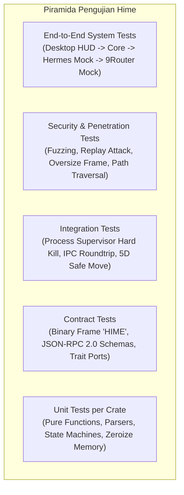

# Quality Assurance Strategy & Definition of Done Specification

- **Document ID:** HIME-SPEC-04-08
- **Task ID:** TASK-04-08 (QA & Definition of Done Specification)
- **Phase:** Phase 04 — Engineering Planning & Implementation Specification
- **Authority:** System Architect & Technical Lead
- **Execution Role:** QA & Governance Lead, Senior Software Engineer
- **Status:** **VALIDATED TECHNICAL SPECIFICATION — 0 TESTS EXECUTED (SPECIFICATION STAGE)**
- **Date:** 2026-11-10

---

## 1. Executive Summary & Evidence-First Governance

Dokumen ini mendefinisikan strategi jaminan kualitas (*Quality Assurance / QA*), pembagian kepemilikan pengujian per-crate, matriks keterlacakan kebutuhan ke kasus uji (*Traceability Matrix*), serta kriteria penyelesaian formal (**Definition of Done / DoD**) untuk seluruh komponen ekosistem Hime.

### Batasan Bukti Empiris Kualitas (Evidence-First Rule):
Sesuai aturan tata kelola [`AGENTS.md`](file:///x:/folder_ai/Hime/AGENTS.md):
- **TIDAK ADA SATU PUN TES YANG TELAH DIJALANKAN PADA PHASE 04 (`0 TESTS EXECUTED`).** Seluruh kode pengujian baru direncanakan dalam bentuk spesifikasi test case (*Test Case Specification*) dan baru akan ditulis serta dieksekusi pada Phase 06 (Engineering Foundation) dan Phase 08 (Integration).
- Dilarang keras mengklaim atau menyiratkan bahwa sebuah fitur atau kontrol keamanan telah lulus uji sebelum perintah pengujian dijalankan secara nyata dan dibuktikan dengan rekaman log terminal (`cargo test`).

### Taksonomi Status Pengujian (5 Status Resmi):
1. `TEST SPECIFIED`: Kasus uji telah dirancang dan didefinisikan secara formal dalam spesifikasi (Tahap Phase 04 — Status saat ini).
2. `TEST IMPLEMENTED`: Kode uji telah ditulis di dalam modul pengujian (Tahap Phase 06).
3. `TEST EXECUTED`: Test runner telah dieksekusi pada lingkungan host.
4. `TEST PASSED`: Uji lulus 100% dibuktikan dengan keluaran terminal resmi (Exit code 0).
5. `TEST BLOCKED`: Pengujian terhalang oleh pemblokir implementasi (IB-01 atau IB-02).

---

## 2. Taksonomi & Tingkatan Pengujian (Test Pyramid)



---

## 3. Pembagian Kepemilikan Pengujian Per-Crate (Test Ownership Matrix)

| Target Crate / App | Cakupan Pengujian | Test Runner & Tooling | Penanggung Jawab |
|:---|:---|:---:|:---:|
| **`apps/hime-desktop`** | UI components rendering, hotkey trigger `Alt+Space`, non-activating window hit-test, state transitions HUD. | Vitest + React Testing Library, Playwright (Tauri WebDriver) | Frontend / Desktop Lead |
| **`crates/hime-core`** | State machine orkestrator, Policy Engine 8 permissions, Action Approval modal logic, reverse proxy routing. | `cargo test -p hime-core`, Tokio test runtime | Core Engine Lead |
| **`crates/hime-ipc`** | Biner frame parsing, 16MB pre-allocation check, Named Pipe DACL, scoped nonces sequence, connection reconnect. | `cargo test -p hime-ipc`, Named Pipe test harness | Systems Engineer |
| **`crates/hime-pal`** | Win32 `WM_NCHITTEST` filter hook, multi-monitor safe rects, global hotkey registration, Wayland fallback logic. | `cargo test -p hime-pal`, Win32 Mock API | Platform Engineer |
| **`crates/hime-storage`**| SQLite WAL single-writer transactions, FTS5 trigram tokenization, 5-dimensi duplicate detection, cross-volume safe move. | `cargo test -p hime-storage`, TempDir test harness | Storage Architect |
| **`crates/hime-security`**| Enkripsi/dekripsi Windows DPAPI, generator CSPRNG entropy, memory zeroization verification (`zeroize`). | `cargo test -p hime-security`, Windows Security API | Security Architect |

---

## 4. Matriks Keterlacakan Kebutuhan ke Kasus Uji (Traceability Matrix)

Berikut adalah matriks keterlacakan lengkap yang memetakan seluruh kelompok kebutuhan terhadap pemilik komponen, tipe pengujian, ekspektasi, dan kriteria penerimaan terukur:

| Requirement ID | Component Owner | Test Case ID | Test Type | Expected Result | Acceptance Criteria | Execution Status |
|:---|:---|:---:|:---:|:---|:---|:---:|
| **FR-CORE-01** (Dynamic Island Window) | `hime-desktop` | **TC-UI-01** | E2E / UI | Window morphing 180x32px ke 420x280px berjalan lancar. | Frame time $\le 16.6\text{ms}$ (60 FPS stabil) tanpa dropped frames. | `PLANNED (0 Executed)` |
| **FR-CORE-02** (Global Hotkey Omnibox) | `hime-pal` | **TC-PAL-01** | Integration | Penekanan `Alt+Space` memicu pembukaan omnibox di monitor aktif. | Latensi dari keydown hingga omnibox siap input $\le 100\text{ms}$. | `PLANNED (0 Executed)` |
| **FR-AGENT-01** (Hermes Orchestration) | `hime-core` | **TC-AGT-01** | Contract | Task reasoning multi-step dieksekusi secara deterministik. | Batas konkurensi tepat 1 task aktif ditaati; task kedua antre. | `PLANNED (0 Executed)` |
| **FR-FILE-04** (Cross-Volume Move) | `hime-storage` | **TC-DATA-01**| Integration | Pemindahan berkas lintas drive gagal di tengah proses; data aman. | 0 source loss; berkas sumber 100% utuh dengan hash identik. | `PLANNED (0 Executed)` |
| **FR-FILE-05** (Multilingual Search) | `hime-storage` | **TC-DATA-02**| Unit | FTS5 trigram menemukan teks Jepang/Indonesia/Inggris. | Pencarian substring mengembalikan baris yang cocok dalam $\le 50\text{ms}$. | `PLANNED (0 Executed)` |
| **SEC-01** (Shell Execution Boundary) | `hime-core` | **TC-SEC-01** | Security | Pemanggilan shell destruktif ditahan di PEP; modal approval muncul. | Eksekusi tertahan minimal 500ms; eksekusi ditolak jika user klik cancel. | `PLANNED (0 Executed)` |
| **SEC-02** (DPAPI Vault at Rest) | `hime-security`| **TC-SEC-02** | Security | Kredensial dienkripsi DPAPI; disk tidak memuat string plaintext. | Dump heksadesimal file vault menghasilkan 0 match terhadap raw API key. | `PLANNED (0 Executed)` |
| **SEC-03** (IPC DACL Isolation) | `hime-ipc` | **TC-SEC-03** | Security | Named Pipe menolak koneksi dari Network SID dan Guest SID. | Panggilan `ConnectNamedPipe` dari SID asing menghasilkan `ACCESS_DENIED`. | `PLANNED (0 Executed)` |
| **SEC-04** (IPC Anti-Replay Nonce) | `hime-ipc` | **TC-SEC-04** | Security | Frame dengan sequence nonce lama atau duplikat ditolak. | Server membalas error `REPLAY_ATTACK_DETECTED` dan memutus request. | `PLANNED (0 Executed)` |
| **SEC-05** (IPC OOM Guard 16MB) | `hime-ipc` | **TC-SEC-05** | Security | Frame dengan `PayloadLength > 16MB` ditolak sebelum alokasi. | Socket ditutup seketika; memori proses tidak bertambah $> 1\text{KB}$. | `PLANNED (0 Executed)` |
| **SEC-09** (Zero Secret Leakage) | `hime-core` | **TC-SEC-06** | Security | Log operasional dan stderr subproses dibersihkan dari kredensial. | Regex audit pada file log menghasilkan 0 kemunculan token atau API key. | `PLANNED (0 Executed)` |
| **NFR-PERF-01** (IPC Roundtrip Latency)| `hime-ipc` | **TC-PERF-01**| Benchmark | Pesan IPC roundtrip Hime Core <-> Hermes selesai sangat cepat. | Overhead latensi IPC internal $< 1.0\text{ms}$ pada payload 4KB. | `PLANNED (0 Executed)` |
| **NFR-RES-01** (RAM Budget Idle) | `hime-core` | **TC-RES-01** | Benchmark | Konsumsi RAM total seluruh stack dalam keadaan standby. | RAM Working Set total (Core + Desktop + Hermes + 9Router) $\le 215\text{MB}$.| `PLANNED (0 Executed)` |
| **IB-01 Gate** (9Router Credential) | `hime-security`| **TC-GATE-01**| Security | Kunci komersial tidak pernah ditulis ke basis data 9Router. | `9router.db` terbukti 0 plaintext key; panggilan outbound sukses 200 OK. | `TEST BLOCKED (IB-01 OPEN)` |
| **IB-02 Gate** (Localhost Bypass) | `hime-core` | **TC-GATE-02**| Security | Akses langsung ke port loopback 9Router ditolak tanpa token. | Direct HTTP curl mengembalikan `401 Unauthorized`. | `TEST BLOCKED (IB-02 OPEN)` |

---

## 5. Definisi Penyelesaian Formal (Definition of Done / DoD)

Sebuah modul, task, atau crate dinyatakan selesai (**DONE**) pada Phase 06 dan seterusnya hanya jika memenuhi **Seluruh 7 Kriteria DoD Wajib**:

```text
+---------------------------------------------------------------------------------------+
|                       HIME ENGINEERING DEFINITION OF DONE (DoD)                       |
+---------------------------------------------------------------------------------------+
| [ ] 1. Kepatuhan Spesifikasi: Kode sumber mengimplementasikan 100% kontrak antarmuka    |
|        publik dan batas tanggung jawab yang didefinisikan pada Phase 04.              |
| [ ] 2. Kebersihan Kompilasi: cargo check --workspace dan cargo build --workspace      |
|        lulus dengan 0 ERROR dan 0 COMPILER WARNINGS.                                  |
| [ ] 3. Integritas Pengujian: Seluruh Unit Tests dan Contract Tests lulus 100%        |
|        (cargo test --workspace menghasilkan exit code 0).                             |
| [ ] 4. Verifikasi Keamanan: Lolos audit redaksi secret (0 credential pada log/disk),   |
|        dan lulus verifikasi anti-replay / payload boundary checks.                    |
| [ ] 5. Zero Orphan Verification: Pengujian pembunuhan proses induk membuktikan        |
|        seluruh child processes terbunuh seketika tanpa proses zombie tertinggal.      |
| [ ] 6. Dokumentasi & Traceability: Seluruh fungsi publik memiliki Rustdoc lengkap;    |
|        matriks ketertelusuran kebutuhan telah diperbarui dengan bukti pengujian nyata.|
| [ ] 7. Review & Gate Sign-Off: Telah melalui tinjauan kode oleh Technical Lead dan    |
|        memenuhi gerbang keamanan (Security Gate) terkait.                             |
+---------------------------------------------------------------------------------------+
```
