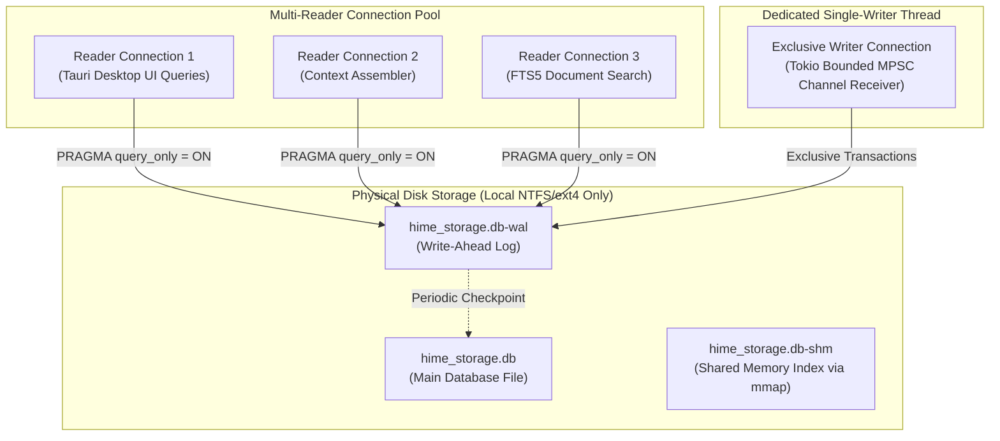
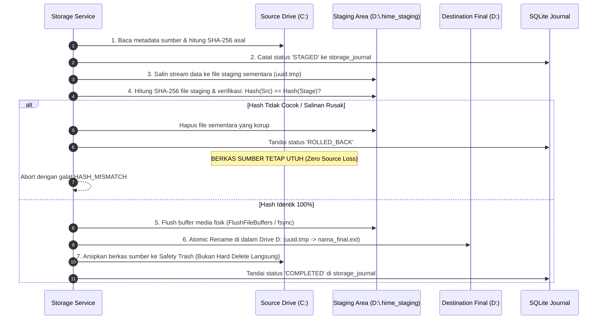

# Storage & Filesystem Safety Specification (5-Dimension Integrity)

- **Document ID:** HIME-SPEC-04-06
- **Task ID:** TASK-04-06 (Storage & Filesystem Safety Specification)
- **Phase:** Phase 04 — Engineering Planning & Implementation Specification
- **Authority:** System Architect & Technical Lead
- **Execution Role:** Senior Storage Architect & Systems Engineer
- **Status:** **VALIDATED TECHNICAL SPECIFICATION**
- **Date:** 2026-11-10

---

## 1. Executive Summary & Storage Philosophy

Dokumen ini mendefinisikan arsitektur penyimpanan lokal, konkurensi basis data SQLite, indeksasi pencarian teks multibahasa, serta **Jaminan Integritas Sistem Berkas 5-Dimensi (*Zero Source File Loss*)** untuk ekosistem Hime.

### Prinsip Mutlak Penyimpanan Data Hime:
1. **Zero Source File Loss:** Sumber berkas asli milik pengguna **TIDAK PERNAH DIHAPUS** sebelum berkas tujuan di-flush ke media fisik dan diverifikasi integritasnya melalui pencocokan hash SHA-256 dan ukuran byte.
2. **Kualifikasi Non-Atomisitas Pemindahan Lintas-Volume:** Pemindahan berkas lintas drive/partisi **BUKAN TRANSAKSI ATOMIK SISTEM OPERASI**. Operasi ini dikelola melalui state machine copy-staging bertingkat dengan jurnal pemulihan crash.
3. **Persetujuan Eksplisit Operasi Destruktif:** Tindakan penghapusan, penggantian berkas (*overwrite*), pemindahan massal, atau pengosongan tempat sampah (*trash purge*) **WAJIB MEMPEROLEH PERSETUJUAN EKSPLISIT** melalui Policy Engine (PEP/PDP) Hime Core.
4. **Kebijakan Retensi Safety Trash Terkelola:** Masa simpan berkas di safety trash (30 hari) adalah batas retensi tinjauan pengguna, **BUKAN PENGHAPUSAN OTOMATIS TANPA KEBIJAKAN**. Hime tidak boleh menghapus berkas secara diam-diam tanpa konfirmasi atau kebijakan yang ditetapkan pengguna.

---

## 2. Arsitektur Basis Data SQLite WAL & Batasan Konkurensi

Hime menggunakan basis data lokal SQLite terkelola (melalui crate `rusqlite` dengan engine SQLite 3.45+ terkompilasi):



### Konfigurasi Pragmas & Transaksi Wajib:
Saat inisialisasi basis data pada cold start, Hime Core mengeksekusi:
```sql
PRAGMA journal_mode = WAL;
PRAGMA synchronous = NORMAL;
PRAGMA foreign_keys = ON;
PRAGMA busy_timeout = 5000;
PRAGMA mmap_size = 268435456; -- 256 MiB memory map
PRAGMA temp_store = MEMORY;
```

### Batasan Sistem Berkas & Konkurensi SQLite WAL:
1. **Larangan Sistem Berkas Jaringan (Network Shares SMB/NFS):**
   - Mode SQLite WAL sangat bergantung pada file indeks memori bersama (`.db-shm`) yang menggunakan pemetaan memori POSIX / Win32 file mapping.
   - Pustaka locking pada protokol jaringan (SMB, CIFS, NFS) tidak mendukung primitif shared memory WAL secara konsisten, yang dapat mengakibatkan korupsi basis data yang tidak dapat diperbaiki (*silent database corruption*).
   - **Batasan Implementasi:** Basis data SQLite Hime **HANYA DIIZINKAN BERADA PADA SISTEM BERKAS LOKAL FISIK** (NTFS pada Windows, ext4/btrfs pada Linux, APFS pada macOS). Jika direktori data pengguna terdeteksi berada di network share, Hime Core wajib menolak inisialisasi mode WAL.
2. **Batasan Konkurensi (Single-Writer Strictness):**
   - Meskipun WAL mengizinkan pembacaan non-blocking konkuren oleh banyak thread (*multi-reader*), SQLite **TETAP MERUPAKAN SINGLE-WRITER DATABASE**.
   - Hime Core mengisolasi seluruh operasi tulis ke dalam satu worker thread khusus (*actor pattern*) melalui channel bounded Tokio. Jika antrean tulis penuh, request baru akan tertahan secara asinkron hingga timeout $5000\text{ms}$.

---

## 3. Skema Pencarian Dokumen Multibahasa FTS5 (Multilingual Search)

### Keterbatasan Tokenizer `unicode61` Standar:
Tokenizer bawaan SQLite FTS5 (`unicode61` dengan `porter` stemmer) hanya memisahkan token berdasarkan spasi (*whitespace*), dan algoritma stemming Porter hanya berlaku untuk bahasa Inggris. Untuk bahasa-bahasa yang tidak menggunakan spasi untuk memisahkan kata (seperti bahasa Jepang Kanji/Hiragana/Katakana atau bahasa Mandarin), `unicode61` memperlakukan seluruh kalimat sebagai satu token tunggal, sehingga pencarian kata kunci di dalamnya gagal total (*Zero Search Match*).

### Solusi Desain Hime: *FTS5 Trigram Tokenizer*
Untuk mendukung pencarian dokumen multibahasa (Bahasa Indonesia, Inggris, Jepang, dan teks teknis) tanpa memerlukan ketergantungan pustaka analisis morfologis eksternal yang berat (seperti MeCab):

```sql
CREATE VIRTUAL TABLE IF NOT EXISTS document_fts USING fts5(
    file_id UNINDEXED,
    file_path,
    file_name,
    content_text,
    content_hash UNINDEXED,
    file_extension UNINDEXED,
    tokenize = 'trigram'
);

CREATE TABLE IF NOT EXISTS storage_journal (
    journal_id INTEGER PRIMARY KEY AUTOINCREMENT,
    operation_type TEXT NOT NULL, -- 'MOVE', 'SAFETY_TRASH', 'TAG'
    source_path TEXT NOT NULL,
    destination_path TEXT NOT NULL,
    source_sha256 TEXT NOT NULL,
    destination_sha256 TEXT,
    staging_path TEXT,
    file_size_bytes INTEGER NOT NULL,
    timestamp INTEGER NOT NULL,
    retention_expires_at INTEGER NOT NULL,
    status TEXT NOT NULL -- 'STAGED', 'VERIFIED', 'COMPLETED', 'ROLLED_BACK'
);
```

### Keunggulan `trigram` Tokenizer:
- Memecah teks menjadi potongan 3 karakter berurutan (*3-character sliding n-grams*).
- Mendukung pencarian substring pada karakter Kanji, Hiragana, Katakana, dan teks alfabet secara native.
- Mampu menemukan kecocokan kata kunci pada teks multibahasa dan cuplikan kode sumber tanpa konfigurasi kamus khusus.

---

## 4. Mesin Pemindahan Berkas Aman (Safe File Move Engine)

### A. Skenario 1: Pemindahan Partisi/Volume Sama (Same-Volume Move)
Jika path sumber dan path tujuan berada pada drive partisi yang sama (misal `C:\FolderA` ke `C:\FolderB`):
- Operasi dieksekusi melalui atomic rename tingkat kernel:
  * **Windows:** Win32 API `MoveFileExW(lpExisting, lpNew, MOVEFILE_REPLACE_EXISTING | MOVEFILE_WRITE_THROUGH)`.
  * **Linux:** Syscall `renameat2(olddir, oldpath, newdir, newpath, RENAME_NOREPLACE)`.
- Sifat: Atomik secara instan di tingkat filesystem (hanya pembaruan pointer metadata inode/MFT).

---

### B. Skenario 2: Pemindahan Lintas-Volume (Non-Atomic 7-Step Verified Sequence)
Operasi pemindahan lintas partisi (misal dari Drive `C:` ke Drive `D:` atau USB Drive) **BUKAN TRANSAKSI ATOMIK**.

Hime Core menjalankan urutan verifikasi ketat 7-langkah:



### Jaminan Keamanan pada Setiap Langkah:
1. **Langkah 1:** File sumber divalidasi keberadaannya; izin baca dan hash awal dihitung.
2. **Langkah 2:** Jurnal dicatat ke database sebelum I/O disk dimulai agar kondisi dapat dilacak jika terjadi crash.
3. **Langkah 3:** Penulisan data selalu diarahkan ke direktori penampungan sementara (`.hime_staging\uuid.tmp`) pada drive tujuan untuk mencegah overwrite parsial pada file tujuan akhir.
4. **Langkah 4:** Integritas data diverifikasi secara kriptografis (SHA-256). Jika ada perbedaan 1 byte, proses dibatalkan seketika. Berkas sumber tetap 100% utuh di lokasi awal.
5. **Langkah 5:** Sistem berkas dipaksa melakukan sinkronisasi fisik ke piringan disk/flash NAND (`FlushFileBuffers` pada Windows, `fdatasync` pada Linux) untuk mencegah kehilangan data akibat cache memori saat listrik padam.
6. **Langkah 6:** Pengubahan nama dari staging ke nama final di drive yang sama bersifat atomik.
7. **Langkah 7:** Sumber asal **TIDAK PERNAH DI-HARD-DELETE SECARA LANGSUNG**, melainkan dipindahkan ke direktori Safety Trash Hime (`%LOCALAPPDATA%\Hime\safety_trash\`) atau ditandai dalam jurnal undo.

---

## 5. Protokol Pemulihan Crash (Crash Recovery Protocol)

Jika mesin host mati mendadak atau proses Hime Core mengalami crash di tengah eksekusi pemindahan berkas:
1. **Staging Recovery on Startup:**
   - Saat Hime Core diluncurkan, storage service membaca entri `storage_journal` yang berstatus `STAGED`.
   - Untuk setiap entri yang tertunda:
     * Jika file staging pada drive tujuan belum selesai atau hash tidak cocok: file staging dihapus bersih; file sumber dipertahankan; status jurnal diubah menjadi `ROLLED_BACK`.
     * Jika file tujuan sudah selesai direname dan diverifikasi tetapi langkah 7 belum selesai: operasi difinalisasi dan pengguna diberitahu.
2. **Zero Orphan Residue:** Seluruh file sementara di direktori `.hime_staging/` yang berumur $> 24\text{ jam}$ dan tidak terikat transaksi aktif otomatis dibersihkan saat cold start.

---

## 6. Kebijakan Retensi Safety Trash & Operasi Destruktif

1. **Persetujuan Eksplisit (PEP/PDP Approval):**
   - Penghapusan file pengguna, modifikasi isi file secara permanen, atau operasi massal ($> 10\text{ file}$) **WAJIB MEMICU ACTION APPROVAL MODAL** dengan penundaan interaktif minimal $500\text{ms}$ untuk mencegah accidental destruction oleh AI agent.
2. **Retensi Safety Trash:**
   - File yang dipindahkan ke Safety Trash dipertahankan selama masa retensi 30 hari.
   - **Batas Retensi = Batas Tinjauan:** Batas 30 hari adalah pengingat bagi pengguna untuk meninjau file. Hime **DILARANG MENGHAPUS BERKAS SECARA OTOMATIS TANPA KONFIRMASI PENGGUNA**. Notifikasi UI akan muncul: *"Terdapat 5 berkas di Safety Trash yang telah berusia 30 hari. Apakah Anda ingin mengosongkannya sekarang?"*
