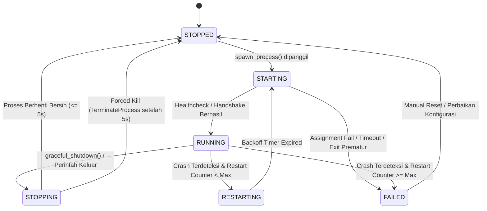
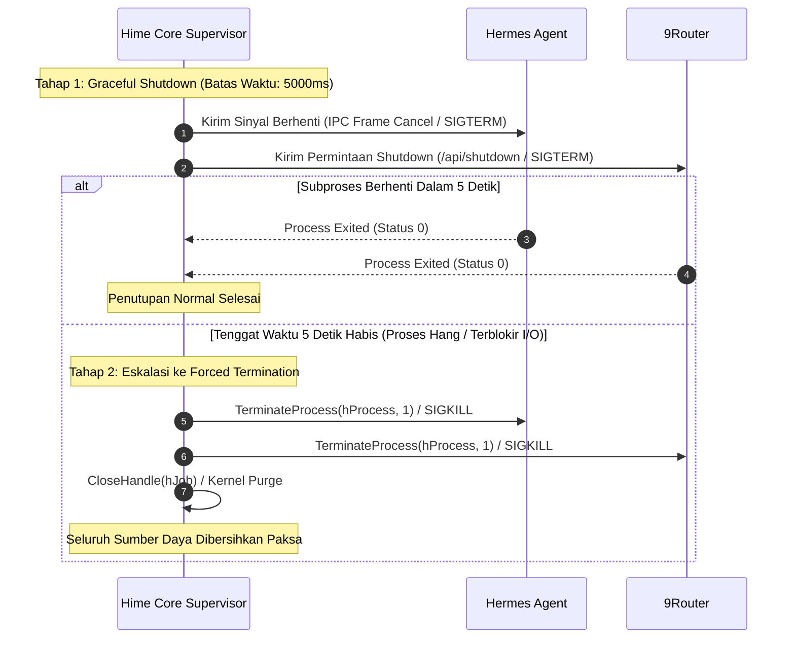

# Subprocess Lifecycle & Process Supervisor Specification

- **Document ID:** HIME-SPEC-04-03
- **Task ID:** TASK-04-03 (Subprocess Lifecycle Specification)
- **Phase:** Phase 04 — Engineering Planning & Implementation Specification
- **Authority:** System Architect & Technical Lead
- **Execution Role:** Senior Systems Engineer & Process Lifecycle Architect
- **Status:** **VALIDATED TECHNICAL SPECIFICATION**
- **Date:** 2026-11-10

---

## 1. Executive Summary & Supervisor Philosophy

Hime Core bertindak sebagai pengawas proses (*Process Supervisor*) tunggal yang mengelola siklus hidup seluruh subproses eksternal:
1. **Hermes Agent Runtime** (Subproses Python via virtual environment `uv`).
2. **9Router AI Gateway** (Subproses Node.js pada port loopback terisolasi).
3. **Proses Pembantu / Local Tools** (File watcher workers, shell utilities).

### Kualifikasi Sasaran Keandalan (*Process Orphanage Mitigation*):
Tujuan utama arsitektur ini adalah meminimalkan risiko tertinggalnya proses anak (*orphan processes*) di memori sistem saat aplikasi Hime ditutup, mengalami crash, atau dimatikan secara mendadak.

**Kualifikasi Klaim Arsitektural:**
Klaim "Zero Orphan Processes" dikualifikasikan sebagai **sasaran rekayasa berbasis penegakan kernel sistem operasi (*Kernel-Enforced Operational Target*)**, bukan jaminan matematis mutlak. Jaminan ini berlaku di bawah kondisi operasional kernel normal dan dibatasi oleh skenario kegagalan ekstrem OS (seperti Blue Screen of Death / kernel panic, pemutusan daya fisik tiba-tiba, atau proses yang terperangkap dalam status I/O driver yang tidak dapat diinterupsi / *uninterruptible D-state*).

---

## 2. Diagram State Machine Siklus Hidup Proses

Setiap subproses yang diawasi oleh Hime Core diatur oleh state machine deterministik:



### Penjelasan Status (State Definitions):
- **`STOPPED`**: Proses tidak aktif; seluruh handle proses dan thread telah ditutup secara aman via RAII; sumber daya sistem telah dibersihkan.
- **`STARTING`**: Proses dibuat dalam status beku (`CREATE_SUSPENDED`); dimasukkan ke Job Object; thread utama di-resume hanya jika assignment sukses; menunggu sinyal kesiapan.
- **`RUNNING`**: Proses beroperasi normal; healthcheck berkala aktif; konsumsi RAM/CPU dipantau.
- **`STOPPING`**: Sinyal terminasi halus dikirimkan (IPC frame cancel / SIGTERM); timer tenggat 5 detik berjalan sebelum eskalasi ke pemaksaan.
- **`RESTARTING`**: Proses mengalami crash tak terduga; supervisor menghitung exponential backoff ($2^n \times 500\text{ms}$) sebelum mencoba peluncuran ulang.
- **`FAILED`**: Batas maksimum percobaan restart (default: 3 kali dalam 5 menit) terlampaui atau terjadi kegagalan kritikal pada assignment supervisor; supervisor berhenti mencoba dan memunculkan notifikasi pada UI Hime.

---

## 3. Penegakan Kernel Windows: Win32 Job Object & `CREATE_SUSPENDED`

Pada Windows, Hime Core memanfaatkan abstraksi kernel **Win32 Job Object** untuk mengikat siklus hidup subproses:

### A. Alur Peluncuran Bebas Race-Condition (`CREATE_SUSPENDED` Pattern)
Untuk mencegah celah waktu (*race condition window*) di mana subproses sempat mengeksekusi instruksi sebelum masuk ke dalam pengawasan Job Object:

```mermaid
sequenceDiagram
    autonumber
    participant Core as Hime Core (Supervisor)
    participant Kernel as Windows Kernel
    participant Sub as Subprocess (Hermes / 9Router)

    Core->>Kernel: CreateJobObjectW(NULL, "HimeJob_...")
    Core->>Kernel: SetInformationJobObject(JOB_OBJECT_LIMIT_KILL_ON_JOB_CLOSE)
    Core->>Kernel: CreateProcessW(flags: CREATE_SUSPENDED)
    Kernel-->>Core: Return hProcess, hThread, PID (Thread Utama Dibekukan)
    Note over Sub: Subprocess Beku di EntryPoint (0 Instruksi Dieksekusi)
    Core->>Kernel: AssignProcessToJobObject(hJob, hProcess)
    alt Assignment Berhasil
        Kernel-->>Core: Return Success
        Core->>Kernel: ResumeThread(hThread)
        Kernel->>Sub: Eksekusi Kode Subproses Dimulai
    else Assignment Gagal (Error OS / Privilese)
        Kernel-->>Core: Return Failure (GetLastError != 0)
        Note over Core: FAIL-CLOSED SAFETY PROTOCOL
        Core->>Kernel: TerminateProcess(hProcess, 1)
        Core->>Kernel: CloseHandle(hThread); CloseHandle(hProcess)
        Note over Core: THREAD TIDAK PERNAH DI-RESUME; SUBPROSES DIMATIKAN SEKETIKA
    end
```

### B. Protokol Kegagalan Assignment (*Fail-Closed Assignment Policy*)
Jika pemanggilan Win32 API `AssignProcessToJobObject` menghasilkan galat (misalnya karena benturan batas sistem atau izin hak akses):
1. Hime Core **DILARANG KERAS** memanggil `ResumeThread(hThread)`.
2. Hime Core wajib seketika mengeksekusi `TerminateProcess(hProcess, 1)`.
3. Seluruh handle proses dan thread langsung ditutup (`CloseHandle`).
4. Supervisor menandai state sebagai `FAILED` dan membatalkan proses startup ekosistem (*Fail-Closed*).

### C. Kebijakan Anti-Breakaway (*Breakaway Prevention Policy*)
Secara default, proses di dalam Job Object dapat mencoba melepaskan diri menggunakan flag `CREATE_BREAKAWAY_FROM_JOB`.
- Hime Core secara eksplisit **TIDAK MENGAKTIFKAN** flag `JOB_OBJECT_LIMIT_BREAKAWAY_OK` maupun `JOB_OBJECT_LIMIT_SILENT_BREAKAWAY_OK`.
- Konfigurasi ini menjamin bahwa setiap proses anak yang dilahirkan oleh Hermes atau 9Router (misalnya subproses Python `multiprocessing` atau worker Node.js) **SECARA OTOMATIS TERPERANGKAP DI DALAM JOB OBJECT YANG SAMA**.

### D. Penanganan Nested Job Objects (Windows 8 / 10 / 11)
- Dimulai dari Windows 8, kernel Windows secara native mendukung *Nested Job Objects*.
- Jika subproses eksternal (misalnya framework Node.js atau runtime tertentu) mencoba membuat Job Object internal miliknya sendiri, kernel Windows memperlakukan Job Object tersebut sebagai anak (*child job*) dari Job Object Hime.
- Batasan dan kuota induk (*parent limits*) tetap berlaku secara hierarkis. Saat Job Object Hime Core ditutup (`KILL_ON_JOB_CLOSE`), seluruh hierarki Job Object turunan beserta proses di dalamnya ikut dimusnahkan oleh kernel.

### E. Manajemen Handle & Pencegahan Kebocoran (*Handle Ownership via RAII*)
- Seluruh handle Win32 (`hJob`, `hProcess`, `hThread`) wajib dibungkus dalam tipe RAII Rust (menggunakan crate `windows` atau wrapper kustom dengan implementasi trait `Drop`).
- `hThread` langsung ditutup (`CloseHandle`) segera setelah `ResumeThread` dipanggil, karena supervisor hanya membutuhkan `hProcess` untuk pemantauan status keluar.
- Implementasi `Drop` pada guard job object menjamin bahwa jika thread Hime Core mengalami panic, fungsi `CloseHandle(hJob)` otomatis dieksekusi saat stack unwinding, yang memicu kernel Windows untuk mematikan seluruh subproses di dalam job tersebut.

---

## 4. Penegakan Pengawasan Proses pada Linux

Karena Win32 Job Objects tidak tersedia pada platform Linux, Hime mengimplementasikan lapisan abstraksi pengawasan proses (*Linux Platform Abstraction Layer*):

### A. Penegakan `PR_SET_PDEATHSIG`
- Saat melakukan `fork()` subproses di Linux, sebelum pemanggilan `execve()`, proses anak wajib memanggil:
  ```c
  prctl(PR_SET_PDEATHSIG, SIGTERM);
  ```
- **Fungsi:** Menjamin bahwa kernel Linux secara otomatis mengirimkan sinyal `SIGTERM` kepada subproses jika proses induk (Hime Core) mati atau terbunuh secara mendadak.

### B. Registrasi Subreaper (`PR_SET_CHILD_SUBREAPER`)
- Hime Core mendaftarkan dirinya sebagai subreaper proses:
  ```c
  prctl(PR_SET_CHILD_SUBREAPER, 1);
  ```
- **Fungsi:** Jika subproses (Hermes/9Router) melahirkan cucu proses dan subproses tersebut mati, proses cucu tidak akan diadopsi oleh `init` (PID 1), melainkan diadopsi oleh Hime Core, sehingga Hime Core tetap dapat memantau dan membersihkan proses cucu tersebut.

### C. Isolasi Kontrol Grup Linux (cgroups v2)
- Pada lingkungan Linux modern dengan systemd / cgroups v2, Hime Core menempatkan subproses dalam cgroup khusus (misal: `/sys/fs/cgroup/user.slice/.../hime-workers/`).
- Saat shutdown atau cleanup paksa, Hime Core menulis `1` ke file `cgroup.kill`, yang secara atomik mematikan seluruh proses yang berada di dalam cgroup tersebut di level kernel.

---

## 5. Prosedur Shutdown Berurutan & Terminasi Paksa

Penghentian subproses dilakukan secara teratur dengan eskalasi waktu deterministik:



### Aturan Eskalasi Terminasi:
1. **Grace Period (5000 ms):** Supervisor memberi kesempatan bagi subproses untuk menyelesaikan transaksi aktif, menutup file SQLite, dan melakukan flush buffer I/O.
2. **Forced Escalation:** Jika subproses tidak keluar dalam waktu 5 detik:
   - Pada Windows: Supervisor memanggil Win32 API `TerminateProcess(hProcess, 1)`.
   - Pada Linux: Supervisor mengirimkan sinyal `SIGKILL (kill -9)`.
3. **Job Object Final Cleanup:** Sebagai lapis pengaman pamungkas, supervisor menutup handle Job Object (`CloseHandle(hJob)`), memastikan tidak ada sisa proses anak atau cucu yang tertinggal.
