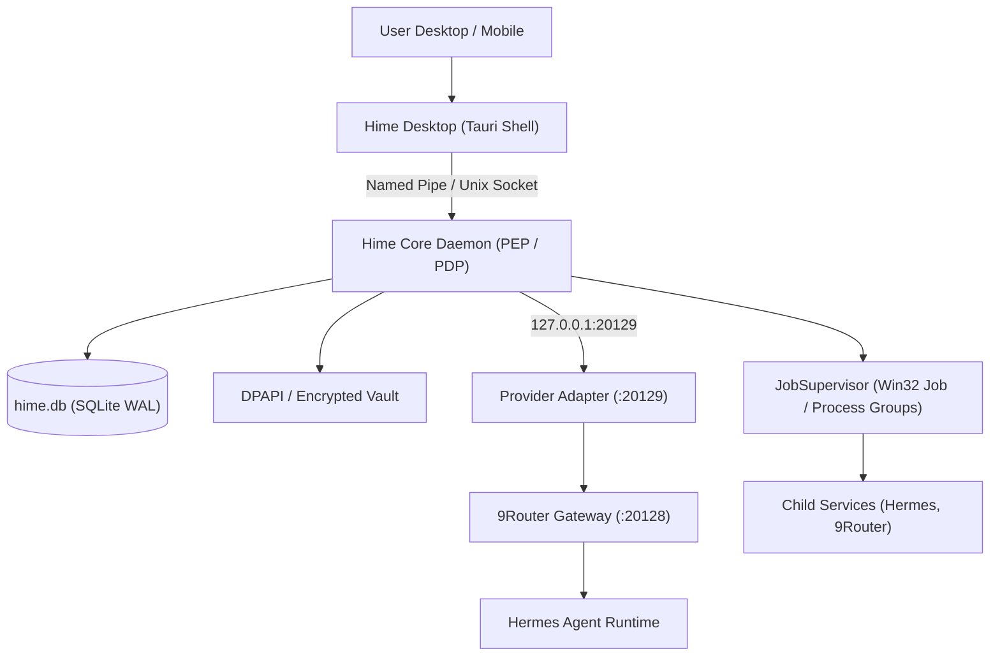

# HIME OPERATIONS & DISASTER RECOVERY RUNBOOK
## System Maintenance & Troubleshooting Manual

**Otoritas:** System Architect & Operations Lead  
**Pelaksana:** Principal Software Engineer & AI Executor  
**Klasifikasi:** Technical Operations Manual  
**Tanggal:** 2026-11-14  

---

## 1. ARCHITECTURE TOPOLOGY



---

## 2. ROUTINE MAINTENANCE OPERATIONS

### 2.1 Database Backup
Hime database is located at `%APPDATA%\Hime\hime.db` (or `~/.local/share/hime/hime.db`).
Because SQLite runs in Write-Ahead Logging (WAL) mode, backup can be performed safely while the daemon is running:
```powershell
# PowerShell SQLite Online Backup:
$backupDir = "$env:APPDATA\Hime\backups"
New-Item -ItemType Directory -Force -Path $backupDir | Out-Null
$timestamp = Get-Date -Format "yyyyMMdd_HHmmss"
Copy-Item "$env:APPDATA\Hime\hime.db" "$backupDir\hime_backup_$timestamp.db"
```

### 2.2 Reclaiming Database Storage (VACUUM)
To optimize file size and defragment SQLite pages:
```powershell
# Can be executed via SQLite CLI or Hime Storage tab -> Maintenance:
sqlite3 "$env:APPDATA\Hime\hime.db" "VACUUM;"
```

### 2.3 Rotating Mobile Pairing Credentials
To revoke all existing mobile pairings and generate fresh mTLS certificates:
1. Open **Notification Center (`Alt+4`)** or navigate to Devices.
2. Click **Revoke All Paired Devices**.
3. All existing session tokens are invalidated instantly. Re-pair active devices using fresh QR codes.

---

## 3. TROUBLESHOOTING & RECOVERY PROCEDURES

### Scenario A: Hime Core Offline / Pipe Connection Refused
**Symptoms:** Desktop UI shows red "Core Offline" banner; commands cannot be dispatched.
**Diagnostics & Fix:**
1. Check if `hime-core.exe` is running:
   ```powershell
   Get-Process -Name hime-core -ErrorAction SilentlyContinue
   ```
2. If the process crashed or was not launched, start it manually or restart Hime Desktop.
3. Check pipe availability:
   ```powershell
   [System.IO.Directory]::GetFiles("\\.\\pipe\\") | Select-String "hime"
   ```
4. If a stale socket file exists on Linux (`/tmp/hime-core.sock`), remove it:
   ```bash
   rm -f /tmp/hime-core.sock
   ```

### Scenario B: Database Locked / Interrupted Transaction
**Symptoms:** SQLite reports `SQLITE_BUSY` or `database is locked`.
**Diagnostics & Fix:**
1. Hime configures busy timeouts of 5,000 ms to handle transient locks automatically.
2. If a hard lock persists due to a crashed process holding the WAL file, terminate all Hime processes:
   ```powershell
   Stop-Process -Name hime-core, Hime -Force -ErrorAction SilentlyContinue
   ```
3. SQLite WAL will automatically replay and recover uncommitted transactions upon next launch.

### Scenario C: Accidental File Deletion Recovery
**Symptoms:** A file was deleted during a storage cleanup task.
**Resolution:**
1. Open **Storage Intelligence (`Alt+5`)**.
2. Click the **Hime Recycle** tab.
3. Locate the file in the audit journal table.
4. Click **1-Click Restore**. Hime verifies the original path, calculates the SHA-256 hash, and moves the file back to its source location.

### Scenario D: Re-indexing Storage Files
**Symptoms:** File search does not return recently added documents.
**Resolution:**
1. Open **Storage Intelligence (`Alt+5`)**.
2. Click **Scan & Re-Index**.
3. The indexer will scan registered workspace folders in the background without locking the UI.

---

## 4. EMERGENCY RESET & ROLLBACK

If local configuration is corrupted beyond recovery:
1. Terminate all Hime processes:
   ```powershell
   Stop-Process -Name hime-core, Hime -Force
   ```
2. Backup the corrupt database for forensic analysis:
   ```powershell
   Rename-Item "$env:APPDATA\Hime\hime.db" "$env:APPDATA\Hime\hime_corrupt.db"
   ```
3. Restart `Hime.exe`. Hime Core will automatically generate a fresh, pristine SQLite database with all tables, triggers, and indices intact.
