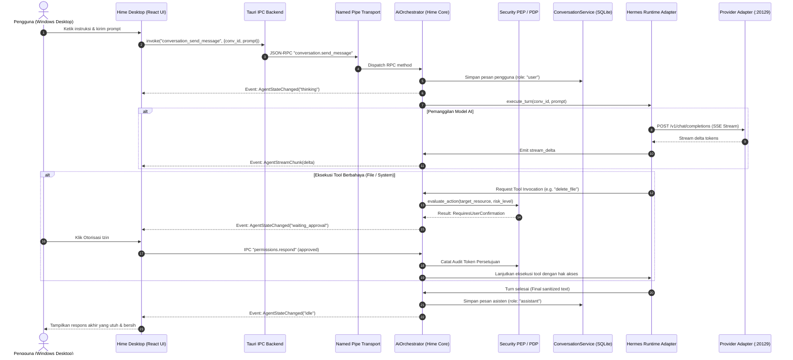

# AI Request Lifecycle & Tool Execution Orchestration

- **Document ID:** HIME-RUNTIME-08-05
- **Phase Covered:** Phase 08 — AI Runtime Integration
- **Classification:** `[VERIFIED AUTOMATED TEST]` & `[VERIFIED STATIC]`
- **Status:** APPROVED TECHNICAL SPECIFICATION
- **Date:** 2026-11-10

---

## 1. Siklus Hidup Permintaan Interaksi AI (*AI Request Lifecycle*)

Setiap interaksi pengguna yang dikirimkan melalui Dynamic Island, Omnibox, atau Conversation View melewati siklus kendali terpusat di dalam Hime Core:

---

## 2. Gatekeeping Eksekusi Tool (*Tool Execution Gateway*)

Hermes Agent dirancang memiliki kemampuan menjalankan tool native (*function calling*). Namun, dalam arsitektur Hime, agen **DILARANG KERAS** mengeksekusi aksi sistem operasi secara langsung tanpa pengawasan Hime Core.

### Mekanisme Pengawasan PEP/PDP:
1. **Penetapan Tingkat Risiko (*Risk Level Classification*):**
   - **Tingkat Rendah (*Low / Read-Only*):** Pembacaan status memori, pencarian model terdaftar, kalkulasi lokal matematika. Diizinkan secara otomatis oleh PDP (*Policy Decision Point*).
   - **Tingkat Sedang (*Medium / Non-Destructive Write*):** Pembuatan catatan sementara, eksekusi query baca file non-kritis. Diberikan izin berbasis durasi sesi aktif.
   - **Tingkat Tinggi (*High / Destructive System Actions*):** Modifikasi file kode, penghapusan data, perubahan konfigurasi jaringan, pemanggilan perintah shell PowerShell. Memerlukan konfirmasi interaktif pengguna secara eksplisit melalui prompt izin Hime Desktop.
2. **Audit Trail Tak Terbantahkan (*Tamper-Resistant Audit Trail*):** Setiap permintaan eksekusi dicatat di dalam tabel `audit_logs` Hime Core lengkap dengan timestamp UTC, nama tool, hash parameter, dan status evaluasi kebijakan.

---

## 3. Manajemen Konkurensi & Pembatalan Interaktif (*Interactive Cancellation*)

Untuk memastikan antarmuka tetap responsif dan konsumsi token tidak sia-sia saat pengguna mengubah pikiran:

1. **Correlation ID Unik:** Setiap sesi turn menghasilkan ID pelacakan UUIDv4 acak.
2. **Channel Pembatalan Instan:** Saat pengguna menekan tombol **"Stop Generation"** di UI atau menekan `Escape` di Omnibox:
   - Frontend memanggil perintah `conversation_cancel`.
   - Hime Core memicu pembatalan pada `tokio::sync::oneshot` sender yang terhubung langsung ke request stream Hermes.
   - Koneksi TCP SSE diputuskan segera, agen beralih seketika ke status `idle`, dan fragmen respons yang sudah diterima tetap disimpan secara aman di SQLite dengan metadata status `cancelled: true`.

---

## 4. Bukti Verifikasi Automatis

Orkestrasi AI diverifikasi secara lengkap melalui:
- **`test_conversation_cancellation` (`crates/hime-core/tests/ai_integration.rs`):** Menguji penghentian generasi secara deterministik tanpa deadlock atau kebocoran resource.
- **`test_desktop_ai_runtime_integration_flow` (`apps/hime-desktop/src-tauri/tests/desktop_integration.rs`):** Menguji transmisi round-trip dari pemanggilan antarmuka desktop, transit pipa bernama, orkestrasi Hime Core, hingga pengembalian payload respons.
- **Status Orkestrasi:** **`VERIFIED AUTOMATED TEST`**.

