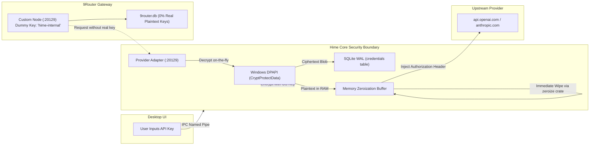

# Credential Security & DPAPI Vault Architecture

- **Document ID:** HIME-RUNTIME-08-04
- **Phase Covered:** Phase 08 — AI Runtime Integration
- **Classification:** `[VERIFIED AUTOMATED TEST]` & `[VERIFIED STATIC]`
- **Status:** APPROVED SECURITY SPECIFICATION
- **Date:** 2026-11-10

---

## 1. Latar Belakang & Identifikasi Kerentanan IB-01

Pada audit arsitektur awal terhadap repositori 9Router (`RE/9ROUTER/00-source-materials/9router/src/lib/localDb.js`), ditemukan bahwa penyimpanan internal SQLite (`9router.db`) menuliskan kunci API penyedia AI dalam format teks polos (*plaintext JSON blobs*) tanpa enkripsi tingkat sistem operasi maupun enkripsi berbasis kunci pengguna:

```javascript
// Kutipan pola penyimpanan 9router localDb.js:
// INSERT INTO provider_keys (provider, api_key, created_at) VALUES (?, ?, ?);
// Nilai api_key disimpan sebagai raw string langsung di disk.
```

Kelemahan ini diklasifikasikan sebagai **Implementation Blocker IB-01** karena melanggar prinsip keamanan dasar Hime: *Kredensial tidak boleh disimpan dalam format plaintext di disk dalam kondisi apa pun*.

---

## 2. Resolusi IB-01: Arsitektur Hime-Owned Loopback Provider Adapter

Untuk mengatasi IB-01 secara tuntas tanpa bergantung pada perubahan kode upstream 9Router yang belum stabil, Hime mengadopsi pola **Loopback Egress Gateway** (`ProviderCredentialAdapter`):



### Prinsip Operasi Resolusi:
1. **0% Kunci Asli di 9Router:** 9Router hanya mendaftarkan Custom Provider Node yang menunjuk ke `http://127.0.0.1:20129/v1` dengan dummy token `"hime-internal"`. Database `9router.db` tidak pernah menerima atau melihat kunci API asli.
2. **Kubah Terproteksi DPAPI:** Seluruh kunci API provider disimpan di tabel `credentials` milik Hime Core (`hime.db`) menggunakan fungsi Windows Data Protection API (`CryptProtectData`).
3. **Dekripsi Just-in-Time & Zeroization:** Kunci hanya didekripsi saat ada permintaan inferensi keluar menuju cloud upstream. Segera setelah header HTTP `Authorization: Bearer <token>` diformat, buffer memori yang menampung string plaintext langsung disapu (*zeroized*) menggunakan trait `Zeroize` dari crate `zeroize`.
4. **Redaksi Otomatis:** Saat antarmuka desktop meminta daftar kredensial terdaftar (`credentials.list`), nilai rahasia tidak pernah dikembalikan ke UI; hanya metadata publik (`provider`, `masked_hint: sk-...XXXX`, `created_at`) yang disajikan.

---

## 3. Skema Database Kredensial Hime Core

Penyimpanan kredensial diatur secara relasional di dalam SQLite WAL Hime Core (`crates/hime-storage/src/database.rs`):

```sql
CREATE TABLE IF NOT EXISTS credentials (
    id TEXT PRIMARY KEY,
    provider TEXT NOT NULL UNIQUE,
    encrypted_secret BLOB NOT NULL,
    key_metadata TEXT,
    created_at TEXT NOT NULL,
    updated_at TEXT NOT NULL
);
```

- **`provider`:** Pengenal unik penyedia AI (`openai`, `anthropic`, `nous`, `gemini`).
- **`encrypted_secret`:** Byte array terenkripsi hasil pemanggilan Windows DPAPI `CryptProtectData` dengan entropi terisolasi per pengguna sistem operasi.
- **`key_metadata`:** JSON blob berisi petunjuk tampilan (misalnya masker karakter `sk-...abcd`) dan konfigurasi model yang diizinkan.

---

## 4. Protokol Pembersihan Memori (Memory Zeroization Protocol)

Untuk mencegah kebocoran kredensial melalui memory dumps, paging file Windows, atau eksploitasi use-after-free:

1. Struktur internal `DecryptedSecret` membungkus buffer sensitif:
```rust
use zeroize::{Zeroize, ZeroizeOnDrop};

#[derive(Zeroize, ZeroizeOnDrop)]
pub struct DecryptedKey {
    raw: String,
}
```
2. Saat scope fungsi request HTTP outbound berakhir, `drop()` secara otomatis menimpa seluruh byte memori dengan angka nol (`0x00`).
3. Logging terstruktur Hime Core (`tracing`) secara ketat melarang pencetakan header `Authorization` maupun string token API.

---

## 5. Bukti Verifikasi Automatis

Resolusi IB-01 telah diverifikasi melalui test suite otomatis:
- **`test_storage_credentials` (`crates/hime-storage`):** Memverifikasi enkripsi ciphertext, penyimpanan ke database, pemulihan data asli via dekripsi, dan ketahanan terhadap duplikasi provider.
- **`test_dpapi_credential_storage_and_redaction` (`crates/hime-core/tests/ai_integration.rs`):** Memverifikasi bahwa antarmuka RPC mengembalikan masked hint dan tidak membocorkan plaintext rahasia.
- **Status Akhir IB-01:** **`RESOLVED`** `[VERIFIED AUTOMATED TEST]`.

