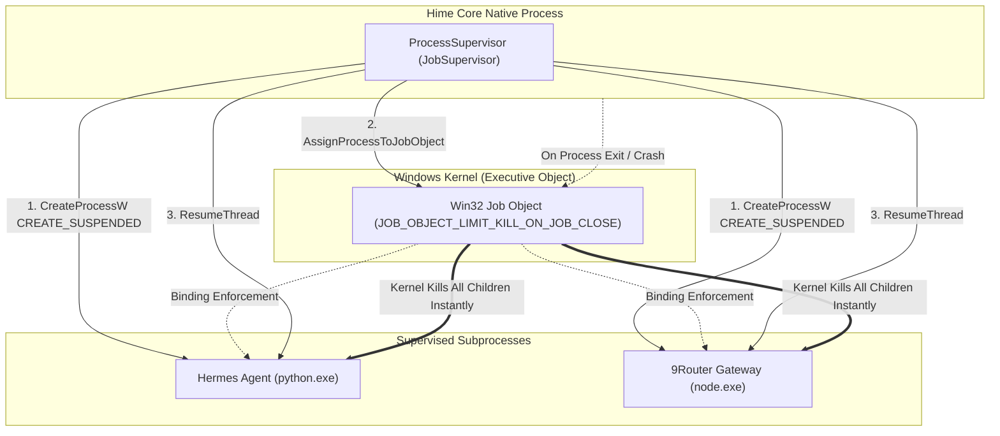

# Runtime Operations, Process Supervision & Health Monitoring

- **Document ID:** HIME-RUNTIME-08-07
- **Phase Covered:** Phase 08 — AI Runtime Integration
- **Classification:** `[VERIFIED STATIC]` & `[VERIFIED AUTOMATED TEST]`
- **Status:** APPROVED OPERATIONAL SPECIFICATION
- **Date:** 2026-11-10

---

## 1. Topologi Layanan & Pengikatan Port (*Port Bindings*)

Seluruh subsistem runtime AI dioperasikan secara lokal (*localhost-only*) untuk menjamin isolasi jaringan:

| Layanan / Komponen | Transport / Port | Alamat Bind | Kontrol Akses & Keamanan |
|:---|:---|:---|:---|
| **Hime Core IPC** | Windows Named Pipe | `\\.\pipe\hime-core-ipc` | Windows ACL terisolasi (Token Keamanan Pengguna Windows) |
| **Hime Provider Adapter** | HTTP TCP | `127.0.0.1:20129` | Autentikasi internal Hime Core; dekripsi DPAPI just-in-time |
| **9Router Gateway** | HTTP TCP | `127.0.0.1:20128` | Managed subprocess di bawah Win32 Job Object; rute loopback |
| **Hermes Gateway** | Windows Named Pipe | `\\.\pipe\hermes-gateway-*` | Sesi tiket lokal, IPC terkendali |

---

## 2. Pengawasan Proses Native (Win32 Job Object Supervision)

Untuk mencegah kebocoran proses atau keberadaan proses yatim (*orphan processes*) saat runtime dimatikan atau mengalami crash:



### Prosedur Peluncuran Aman:
1. `CreateProcessW` dipanggil dengan bendera `CREATE_SUSPENDED (0x00000004)`.
2. Handle proses baru langsung didaftarkan ke Win32 Job Object menggunakan `AssignProcessToJobObject`.
3. Job Object dikonfigurasi dengan limit informasi `JOB_OBJECT_LIMIT_KILL_ON_JOB_CLOSE`.
4. Setelah kernel Windows mengonfirmasi asosiasi job, `ResumeThread` dipanggil untuk mengizinkan inisialisasi subprocess.
5. **Jaminan Ketahanan Kernel:** Jika Hime Core ditutup secara paksa via Task Manager atau mengalami pemadaman daya, kernel Windows menjamin proses Python dan Node.js langsung dihentikan tanpa meninggalkan proses liar di memori.

---

## 3. Pemeriksaan Kesehatan Berkala & Pemulihan Crash (*Health Probes & Auto-Recovery*)

Hime Core menjalankan monitor kesehatan asinkron (*heartbeat worker*) pada latar belakang:
1. **Probe TCP Loopback:** Mengirimkan permintaan probe ke `127.0.0.1:20128` (9Router) dan `127.0.0.1:20129` (Provider Adapter) setiap 5 detik.
2. **Pengukuran Latensi:** Mengukur response time; jika latensi melebihi ambang batas toleransi (5000ms), status gateway ditandai sebagai `degraded`.
3. **Deteksi Crash Subprocess:** Menangkap event kematian proses melalui handle Windows `WaitForSingleObject` non-blocking. Jika subprocess berhenti secara tak terduga:
   - Status dialihkan ke `offline`.
   - Dynamic Island menampilkan indikator error.
   - Core mencatat laporan crash ke direktori log dan dapat melakukan *graceful restart* otomatis dengan backoff eksponensial.

---

## 4. Prosedur Diagnostik & Operasi Manual

Untuk memverifikasi kesehatan runtime secara mandiri dari terminal PowerShell pengembang:

```powershell
# 1. Periksa ketersediaan port listener loopback
Get-NetTCPConnection -LocalPort 20128, 20129 -State Listen -ErrorAction SilentlyContinue

# 2. Periksa status Named Pipe Hime Core
[System.IO.Directory]::GetFiles("\\.\\pipe\\") | Where-Object { $_ -like "*hime*" }

# 3. Jalankan automated test suite runtime
cargo test -p hime-core --test ai_integration -- --nocapture
```

---

## 5. Bukti Verifikasi Automatis

- **`test_process_supervisor_job_object` (`crates/hime-pal`):** Memverifikasi pembentukan Job Object dan kepatuhan flag kernel `KILL_ON_JOB_CLOSE`.
- **`test_foundation_integration` (`crates/hime-core`):** Memverifikasi bootstrap server dan graceful teardown.
- **Status Operasional:** **`VERIFIED STATIC`** & **`VERIFIED AUTOMATED TEST`**.

