# Streaming Protocol & Real-Time Event Dispatching

- **Document ID:** HIME-RUNTIME-08-06
- **Phase Covered:** Phase 08 — AI Runtime Integration
- **Classification:** `[VERIFIED AUTOMATED TEST]` & `[VERIFIED STATIC]`
- **Status:** APPROVED TECHNICAL SPECIFICATION
- **Date:** 2026-11-10

---

## 1. Topologi Streaming End-to-End

Arsitektur streaming Hime menghubungkan output model AI yang berbasis Server-Sent Events (SSE) ke antarmuka pengguna React 18 melalui transport IPC Named Pipe berkecepatan tinggi dengan overhead minimal:

```mermaid
flowchart LR
    subgraph Provider ["Loopback Provider Adapter"]
        SSE["SSE Token Stream (HTTP chunked)"]
    end

    subgraph Core ["Hime Core Runtime"]
        Filter["SEC-09 Redaction Engine"]
        Bus["Tokio Broadcast Event Bus"]
        Framing["IPC Binary Frame Encoder"]
    end

    subgraph Desktop ["Hime Desktop Shell"]
        Pipe["Named Pipe Client (Tauri Backend)"]
        Emitter["Tauri Window Event Emitter"]
        UI["React 18 Markdown Renderer"]
    end

    SSE --> Filter
    Filter -->|Sanitized Chunks| Bus
    Bus --> Framing
    Framing -->|Named Pipe Binary Packet| Pipe
    Pipe -->|Window Emit 'agent:stream'| Emitter
    Emitter --> UI
```



---

## 2. Format Paket IPC Binary Framing

Transmisi streaming melalui Named Pipe menggunakan format frame biner 9-byte header standar Phase 06:

```text
+-------------------+--------------------+----------------------+------------------------+-------------------+
| Magic (2B): 0x484D| Version (1B): 0x01 | FrameType (1B): 0x03 | Correlation ID (4B)    | Payload Len (4B)  |
+-------------------+--------------------+----------------------+------------------------+-------------------+
| Payload (N Bytes): JSON UTF-8 { "event": "AgentStreamChunk", "data": { "delta": "..." } }                  |
+------------------------------------------------------------------------------------------------------------+
```

- **`FrameType::Event (0x03)`:** Memungkinkan pengiriman event asinkron dari Core ke Desktop tanpa harus menunggu atau memblokir siklus Request-Response JSON-RPC reguler.
- **`Correlation ID`:** Menjamin paket streaming terikat secara deterministik pada giliran pesan (*turn*) yang aktif, mencegah tercampurnya stream jika terjadi pergantian thread cepat oleh pengguna.

---

## 3. Penegakan Privasi Penalaran Agen Mutlak (SEC-09 Zero Private CoT Exposure)

### Latar Belakang & Ancaman Privasi:
Model penalaran modern (*reasoning models*) seperti DeepSeek-R1, Qwen-Thinking, dan Nous Hermes mengeluarkan token penalaran internal dalam blok tag penanda (`<think>...</think>` atau `<thought>...</thought>`). Token-token ini seringkali mengandung dekomposisi mentah, strategi internal, maupun token sementara yang tidak layak disajikan kepada pengguna dan dapat membocorkan logika keamanan.

### Implementasi Engine Redaksi Hime Core:
Diimplementasikan pada `crates/hime-security/src/redaction.rs` dan diintegrasikan langsung pada `HermesRuntimeAdapter`:

```rust
pub fn redact_sensitive_text(input: &str) -> String {
    // 1. Redaksi tag penalaran <think>...</think> dan <thought>...</thought>
    static THINK_RE: Lazy<Regex> = Lazy::new(|| Regex::new(r"(?s)<think>.*?</think>").unwrap());
    static THOUGHT_RE: Lazy<Regex> = Lazy::new(|| Regex::new(r"(?s)<thought>.*?</thought>").unwrap());

    // 2. Redaksi kunci rahasia API (sk-..., np_..., dll)
    static KEY_RE: Lazy<Regex> = Lazy::new(|| Regex::new(r"(sk-[a-zA-Z0-9_\-]{20,})").unwrap());

    let mut result = THINK_RE.replace_all(input, "").to_string();
    result = THOUGHT_RE.replace_all(&result, "").to_string();
    result = KEY_RE.replace_all(&result, "[REDACTED_API_KEY]").to_string();
    
    result.trim().to_string()
}
```

### Jaminan Keamanan SEC-09:
1. **Penyaringan Sisi Server (Server-Side Enforcement):** Redaksi dilakukan di dalam proses Hime Core **sebelum** paket streaming dikirimkan melalui Named Pipe. Frontend tidak pernah menerima teks CoT mentah.
2. **Pembersihan Log Terstruktur:** Logger tracing Hime Core menerapkan filter yang sama pada level log `INFO` dan `DEBUG`.
3. **Pemberitahuan Status Tanpa Teks Mentah:** Antarmuka Dynamic Island menerima event status terpisah (`AgentStateChanged::Thinking`) untuk menampilkan animasi visual tanpa harus membaca isi penalaran.

---

## 4. Bukti Verifikasi Automatis

- **`test_chain_of_thought_and_key_redaction` (`crates/hime-security/src/redaction.rs`):** Memverifikasi penghapusan total tag `<think>` dan sensor kunci API `sk-...`.
- **`test_provider_adapter_loopback_streaming` (`crates/hime-core/tests/ai_integration.rs`):** Memverifikasi emisi Server-Sent Events (SSE) loopback dan penguraian chunk respons.
- **Status Penegakan Streaming & SEC-09:** **`VERIFIED AUTOMATED TEST`**.

